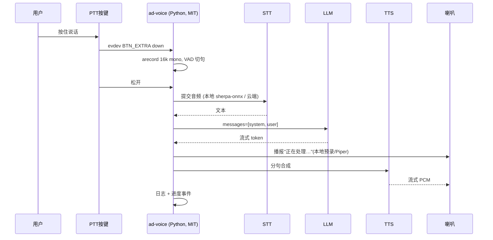

# AD（Advanced Desktop）鼠标形无屏微型计算机 — 设计方案 v0.1

> 阶段：**设计方案（Design Review）**。本文不含下单、采购、任何站点改动。
> 目标：给出可采购、可手工焊接验证、成本可算的路线，供评审拍板后再进 MVP 打样。
> 标注约定：**【实测】**必须动手验证；**【询价】**价格/供货需现场或线上确认；**【风险】**已知可能翻车点。

---

## 0. 结论先行

**能做，但要做对三件事：选 H618 级 SoC、音频走 USB 而不是 I2S、光标走"自己读传感器 + uinput"而不是 USB HID 从设备。**

| 项目 | 结论 |
|---|---|
| 一句话可行性 | 可行。1080p60 桌面 + 语音进语音出 + 自身位移驱动光标，在一颗 4×A53 的 H618 上全部成立，已有成熟板卡与镜像。 |
| 单台手工样品成本 | **稳妥版 ≈ 300–350 元**；**降本版 ≈ 170–200 元**（复用废鼠标光学件 + 自备电源） |
| 小批量（100 台）预估 | ≈ 150–200 元/台 + 一次性 NRE 1500–3000 元（自绘载板 + 贴片打样）**【询价】** |
| 首选主控 | 全志 **H618**，Orange Pi Zero 3 1GB（85×56mm，原生 micro HDMI 2.0a，3 路 USB2.0 Host） |
| 首选音频 | **USB 声卡模块（CM108）+ PAM8403 + 28mm 8Ω 2W 喇叭**；I2S 留给二代载板 |
| 首选光标 | PMW3389（SPI）→ 用户态读位移 → `/dev/uinput` 注入 REL_X/REL_Y |
| 首选 AI 链路 | 按键说话 → sherpa-onnx(STT) → 云端 LLM / 本地降级 → piper(TTS) → 播放 |
| 明确否决 | 树莓派（用户排除 + 贵）、RV1106/Milk-V Duo（无 HDMI）、D1/Lichee RV（单核跑桌面吃力）、电视棒/盒子拆板（闭源 + BMC 签名 + 供货灰色）、FreeBSD（这些 SoC 上根本跑不起来） |
| 最大风险 | ① 鼠标壳内的**结构 + 散热**冲突；② 自制**光学取光机构**导致光标抖动/丢帧 |

**必须先说清的一件事**：这个价位的 SoC（全志/瑞芯微/晶晨）**不存在真正意义的开源硬件**。芯片 datasheet 需 NDA、参考设计不公开、GPU/VPU 驱动二进制闭源。我们能开源的是：**载板原理图/PCB、固件、应用层**。SoC 本身开不了源，这是物理现实，不是路线选择问题。

---

## 1. 产品定义（工程转译）

| 用户语言 | 工程定义 | 验收口径 |
|---|---|---|
| 鼠标形状的电脑 | 135×80×40mm 级右手人体工学壳，内含完整 SBC | 单手可握持、可在桌面平移 |
| 没有屏幕 | 无 LCD/OLED，仅 HDMI 输出 | 整机无本地显示器件 |
| 说话就是输入 | 按键说话（PTT）+ 单麦采集 16kHz 单声道 | 3 秒语音可被识别 |
| 播报进度和结果 | TTS 流式播放，分段播报 | 首字延迟 ≤2.5s |
| 移动就动光标 | 光学传感器位移 → 系统光标 | 25.4mm 位移误差 ≤3% |
| 开源硬件 | 载板 CERN-OHL-S + 固件 MIT + 应用 MIT | 交付可编辑源文件 |
| 商用免费 | 内核 GPL-2.0 合规 + 用户态 MIT | 随货提供源码获取方式 |

### 1.1 系统架构

```mermaid
flowchart LR
  subgraph 输入
    A[PMW3389 光学传感器<br/>SPI 4线] --> B[SoC: H618<br/>4×A53 1.5GHz<br/>1GB LPDDR4]
    K[PTT 按键 / 左中右键] --> B
    M[驻极体麦克风] --> S[USB 声卡 CM108<br/>UAC1.0]
    S --> B
  end
  subgraph 输出
    B -->|micro HDMI 2.0a| D[外接显示器/电视<br/>1080p60]
    B -->|I2S 或 USB| P[PAM8403 功放]
    P --> SPK[28mm 8Ω 2W 喇叭]
  end
  B -.WiFi 2.4/5G.-> C[云端 LLM / STT / TTS]
  B --> SD[(microSD 32GB<br/>系统 + 模型)]
  PS[5V/3A USB-C 电源] --> B
  PS --> P
```

ASCII 版（无 Mermaid 环境时看这个）：

```
        ┌────────────── 5V/3A USB-C ──────────────┐
        │                                          │
 ┌──────┴───────┐    micro HDMI 2.0a    ┌──────────┴────────┐
 │  PMW3389     │ SPI                  │                    │
 │  光学传感器  ├──────┐               │   H618 主板        │──HDMI──▶ 显示器 1080p60
 └──────────────┘      │               │  Orange Pi Zero3   │
 ┌──────────────┐      ├──USB2.0──────▶│  4×A53 / 1GB       │
 │ CM108 USB    │◀─────┤               │  microSD / WiFi    │
 │ 声卡(麦+耳机)│      │               │                    │
 └───┬──────┬───┘      │               └─────────┬──────────┘
     │      │          │                         │ I2S(未引出)/Line-out
  麦克风  Line-out      │                         ▼
                   ┌───┴────┐              ┌────────────┐
                   │ PTT/左 │              │ PAM8403    │──▶ 28mm 喇叭
                   │ 中 右  │              │ 3W D类功放 │
                   └────────┘              └────────────┘
```

### 1.2 关键尺寸约束（先定这个，否则后面全返工）

| 部件 | 尺寸 | 说明 |
|---|---|---|
| Orange Pi Zero 3 | **85 × 56 mm** | 这是硬约束。标准小鼠（120×62）装不下，必须用**大号人体工学壳**（≈135×80×42） |
| 28mm 喇叭 | φ28 × 5mm | 需独立后腔 ≥2cc |
| 电池（若带） | 2000mAh 软包 ≈ 60×35×8mm | 与板、喇叭抢空间 |
| 光学模组 | 透镜面距桌面 **1.8–2.5mm** | 由透镜型号决定，不能拍脑袋 |

> **【风险】这是全案第一个卡点**：85×56 的板 + 喇叭腔 + 电池 + 散热片，四样东西塞进 135×80×42 的壳，余量只有几毫米。结构必须在 P0 阶段就用纸板/泡沫做出实体模型验证，不要等 3D 打印出来才发现装不进。

---

## 2. 问题 1：主控选型

### 2.1 候选对比

| 候选 | 原生 HDMI | 成本 | 开源程度 | 国内可得性 | 跑桌面能力 | 结论 |
|---|---|---|---|---|---|---|
| **全志 H618**（Orange Pi Zero 3） | ✅ micro HDMI 2.0a 4K60 | 100–160 元【询价】 | 官方发原理图 PDF（非可编辑源）；SoC 需 NDA | 淘宝/天猫现货，非常好买 | 4×A53@1.5G + G31，1080p 桌面流畅 | **首选** |
| 全志 H616（MangoPi MQ-Quad） | ✅ mini HDMI | 80–120 元【询价】 | 同上，社区有主线尝试 | 淘宝有，量少 | 同 H618，略低 | **备选**（65×30mm 更适合鼠标壳，但只有 1 路 USB Host） |
| 瑞芯微 RV1106/RV1103（Luckfox Pico） | ❌ 只有 MIPI/RGB，无 HDMI | 40–80 元 | SoC 资料相对开放 | 好买 | A7 单核 + NPU，跑不了桌面 | **淘汰**（不满足"外接显示器"这条硬需求） |
| Milk-V Duo（CV1800B） | ❌ 无显示输出（Duo 256M 仅 MIPI DSI） | 40–70 元 | 开放度较好 | 好买 | RISC-V 1GHz，无桌面 | **淘汰**（同上） |
| 全志 D1 / Lichee RV | ⚠️ 无原生 HDMI，需 RGB→HDMI 桥 | 70–120 元 | 主线支持最好 | 一般 | 单核 C906@1GHz，桌面 + 语音 + 浏览器吃不消 | **淘汰**（性能） |
| 晶晨 S905/S905X 电视棒拆板 | ✅ HDMI 2.0 | 30–80 元（灰色） | ❌ 无原理图、BootROM 签名、固件闭源 | 灰渠道 | 流畅 | **淘汰**（不可开源、不可维护、法律与供货风险） |
| 树莓派 Zero 2W / Pi 4 | ✅ | 200–600 元 | 好 | 需代购/溢价 | 流畅 | **淘汰**（用户明确排除 + 成本） |
| Radxa Zero 3W（RK3566） | ✅ micro HDMI | 160–220 元 | 较好，主线支持不错 | 好买 | 更强 | **备选 B**（愿意加 80 元换性能与主线成熟度时选） |

### 2.2 结论与证据

**首选：Orange Pi Zero 3（H618，1GB）**

理由（按权重排序）：

1. **原生 HDMI 直接可用**，不需要任何桥接芯片。这是整个产品"无屏但有画面"的命门。
2. **3 路 USB 2.0 Host**（板载 1 个 Type-A + 13pin 扩展板 2 个）。手工样品要同时接"USB 声卡 + 鼠标模块/键盘"，口多就是省事。
3. **镜像现成**：官方 Debian/Ubuntu 镜像 + Armbian 均有 orangepi-zero3 支持，HDMI 输出开箱可用。
4. **尺寸 85×56mm**，能塞进大号鼠标壳（代价是壳必须大）。
5. 价格在"百元级"，符合"别用树莓派那种贵件"。

**必须如实说明的瑕疵：**

- **主线内核的 HDMI 支持不完整**。Linux 主线对 H616/H618 的显示引擎 + TCON 支持在 2025 年年中才进入 drm-misc-next（`sun4i: Add H616 Support`），**HDMI 输出（DW-HDMI + PHY）是后续 patch，尚未完整合入**。因此现在能跑的是**厂商 BSP 内核分支**（Armbian 的 Zero 3 镜像即走这条路），不是 kernel.org 干净主线。
  → 影响：能用、能长期维护，但"纯主线、可完全自主掌控"这个说法**现在不成立**，要等主线 HDMI 落地。【实测】拿到板后请立刻验证 `modetest`/亮度与音频是否走 HDMI。
- **原理图是 PDF 不是源文件**。Orange Pi 公开原理图（可读、可抄），但不提供 KiCad/Altium 源工程；SoC datasheet 需签 NDA。→ 我们自绘载板时是"照着 PDF 重画"，这也正好构成我们自己的开源成果。
- WiFi/BT 用 AW859A，**固件是二进制 blob**（可再分发、不可修改）。

**备选 A：MangoPi MQ-Quad（H616，65×30mm）**
- 唯一优势：**65×30mm，真正能塞进标准鼠标壳**，不用做大号外壳。
- 代价：只有 **1 路 USB Host（Type-C）**，接了声卡就没口接鼠标模块，必须加 USB Hub；社区/镜像支持弱于香橙派；HDMI 可用性需自测。
- 适用：如果你坚持"必须是正常鼠标手感"，选它。

**备选 B：Radxa Zero 3W（RK3566）**
- 主线支持更成熟（HDMI/Panfrost 都更完整），性能够跑本地小模型。
- 代价：贵 80–120 元，且 RK3566 在鼠标壳里更热。
- 适用：预算宽松、且希望"少折腾内核"。

### 2.3 电视棒拆板为什么不行（不是道德问题，是工程问题）

1. **无法开源**：Amlogic BootROM 有签名校验，你改不了 bootloader，谈何"开源固件"。
2. **无 GPIO/I2S 引出**：光学传感器和按键没地方接，只能靠 USB，把"自制硬件"降级成"给电视棒装个壳"。
3. **供货不可控**：拆机板批次不一致、随时断供，做不了产品。
4. **法律风险**：整机认证（3C/SRRC）无法对应到拆机模块。

---

## 3. 问题 2：显示接口

### 3.1 结论：只用原生 HDMI，不用 MIPI→HDMI 桥

| 维度 | 原生 HDMI（H618） | MIPI DSI → LT8912B → HDMI |
|---|---|---|
| 额外器件 | 0 | LT8912B（QFN-64，0.5mm 脚距）+ 晶振 + LDO + ESD + HDMI 连接器 |
| 成本 | 0 | 芯片 5–15 元【询价】，加外围约 20–25 元 |
| 手工焊接 | 不涉及 | **QFN-64 手焊基本不可能**，必须回流焊/钢网 |
| 上限 | 4K60 | 1080p60 |
| 调试成本 | 低（板厂已做好） | 高（EDID 透传、HDCP、上电时序、I2C 配置全要自己搞） |
| 结论 | **选它** | 只在 SoC 无 HDMI 时才考虑（本方案不需要） |

**分辨率与刷新率**：产品定位是"桌面 + 语音"，**固定 1080p60**。理由：4K60 会让 H618 的 GPU/内存带宽和功耗飙升（在鼠标壳里散热扛不住），而 1080p 对文本/网页/AI 界面完全够。UI 层按 1080p 设计，允许 720p 自动降级。

**热插拔与 EDID**：由内核 DRM 驱动处理，用户态靠 `libinput`/合成器自动重配。注意 H618 的 HDMI 在 BSP 内核上偶发"插上不亮"，需要在启动脚本里加 `modetest` 强制模式或重启合成器。【实测】

**外接屏供电怎么走**：
- HDMI 线**不供电**，别想从显示器取电。
- 便携屏（USB-C 供电型）需要 5V/2–3A：用 **5V/3A 电源 → USB-C 分线（一进两出）→ 一路给 AD、一路给屏**。
- 桌面显示器自己插墙，AD 单独 5V 供电即可。
- **micro HDMI 座机械强度差**：鼠标会动，线会拽。必须做线缆应力释放（壳内做卡扣 + 短线转接到 HDMI 母座），否则第一个坏的就是这个座子。【风险】

---

## 4. 问题 3：光标功能

### 4.1 结论：传感器 → SoC → uinput → 合成器

```
PMW3389 (SPI) ──► /dev/spidevX.Y 读 ΔX/ΔY
                        │
                        ▼
              ad-moused (用户态守护进程, MIT)
              · 读原始位移 + 按键状态
              · 做 CPI 换算 / 平滑 / 加速曲线
                        │
                        ▼
              /dev/uinput  ──► 创建虚拟设备:
                                REL_X / REL_Y / BTN_LEFT / BTN_RIGHT / BTN_MIDDLE
                        │
                        ▼
              libinput ──► Wayland 合成器(labwc/sway) 或 X11 ──► 屏幕光标
```

关键点：

- **为什么必须走 uinput**：这是 Linux 唯一"用户态生成输入事件"的标准接口，权限只需 udev 规则，不需要 root，不需要改内核。
- **为什么不让合成器直接读传感器**：会把硬件耦合进窗口系统，换合成器就重写。分层后 `ad-moused` 是独立可测单元（P1 只测它，不碰 UI）。
- **CPI 换算**：设定 1000 CPI，即 1 英寸（25.4mm）位移 = 1000 counts。传感器原始 counts 需要按寄存器配置的 DPI 做比例换算，并做 **1:1 直通**（默认关闭指针加速），否则"线性度"验收过不了。

### 4.2 为什么不做"USB HID 从设备"（插到别人电脑当鼠标）

这条路线听起来更"通用"，但在本产品里是**歧义 + 工程障碍**：

1. **硬件不支持**：Orange Pi Zero 3 的 USB-C 是**纯供电输入**，没有 OTG/Device 模式；即使有，也要配 USB gadget 复合设备（HID + 网卡 + 存储），调试复杂度翻倍。
2. **语义歧义**：AD 自己就是一台电脑，光标该出现在**自己的 HDMI 屏**上。做成"给别人用的鼠标"，用户会问"那我到底在操作哪台机器？"
3. **供电地环路**：从设备模式要从主机取电，同时自己又要 5V 供电，容易形成地环路和倒灌。
4. **产品定位错位**：那样它就退化成"一个带麦的鼠标"，价值只剩外壳。

### 4.3 如果确实要"接到别人电脑当鼠标"——加一个物理模式开关

不改主路径，**旁路实现**：

```
                    ┌── 模式开关 (2档拨动, 物理切断) ──┐
PMW3389 SPI ────────┤                                  │
                    ├─ 档位1 → H618 (AD 自身光标)
                    └─ 档位2 → ESP32-S3 (USB HID 设备, ~15元)
                                     │
                                     └─ USB-C → 别人电脑, 即插即用标准鼠标
```

- 用 **ESP32-S3**（自带 USB-OTG，可做 HID）读同一颗传感器的 SPI，输出标准 HID 鼠标。
- 开关**同时切换 SPI 的 CS 和供电**，保证两条路径永不同时占用总线（否则 SPI 冲突会读花）。
- 成本：+18 元，+6g。**建议放到 v2**，MVP 不做。

---

## 5. 问题 4：光学传感器

### 5.1 候选对比

| 型号 | 分辨率 | 接口 | 封装/焊接 | 透镜 | 资料开放度 | 单价【询价】 | 结论 |
|---|---|---|---|---|---|---|---|
| **PMW3389DM-T3QU** | 16000 CPI | **SPI 4线** + MOTION | DIP 式 16 脚，**可手焊** | LM19-LSI | 寄存器被社区广泛逆向，有开源驱动 | 4–42 元（克隆/原装差 10 倍） | **首选** |
| PAW3395DM-T6QU | 26000 CPI | 私有 SPI 变体 | DIP 16 脚，可手焊 | L0AE-LSI | **datasheet 需 NDA**，寄存器不公开 | 55–100 元 | 备选（性能过剩，逆向成本高） |
| ADNS-9800 | 8200 CPI | **SPI（协议公开）** | DIP，可手焊 | ADNS-6190 | **官方 datasheet 完整公开**，最"开源友好" | 50–120 元，已停产偏贵 | 备选 B（资料最好、供货最差） |
| 国产替代 | — | 多为私有单线 | — | — | — | — | **基本不存在**。光学鼠标传感器几乎被原相（PixArt）垄断，没有真正可替代的开源方案 |

### 5.2 结论

**首选 PMW3389DM-T3QU + LM19-LSI 透镜。**

- **封装**：DIP 式 16 脚，脚距适合手工焊接（比 QFN 友好一个数量级）。这是它胜过 PAW3395 的关键之一。
- **接口**：标准 4 线 SPI（SCLK/MOSI/MISO/CS）+ MOTION 中断脚，H618 的 26pin 上有 SPI0，可直接接。
- **资料**：寄存器表虽非官方公开，但社区逆向充分（Arduino/STM32 驱动一大堆），改写成 Linux 用户态 SPI 程序的工作量约 1–2 天。
- **价格陷阱**：淘宝 4 元和 42 元的"同型号"差别巨大，4 元多为翻新/打磨片。**建议买 40 元档**，先买 2 颗备用。【询价】

### 5.3 透镜与光路（这是最容易翻车的地方）

**结论：必须用成品透镜 + 成品光学腔，不要试图自己设计光路。**

- 传感器裸片不能直接看桌面，必须有 **LM19-LSI 这类透镜**把桌面纹理成像到传感器感光面。
- 透镜与传感器的**相对位置（Z 向高度 ±0.1mm）**、LED 入射角、遮光结构，共同决定成像对比度。差 0.2mm 就会出现"低速可用、快速丢帧"。
- 所以：**买"传感器 + 透镜"配套件，然后从一个报废鼠标上拆下它的光学腔支架（黑色塑料件），把配套件装进去**。这是最省事、成功率最高的做法，成本 5 元。
- 离地高度：严格按透镜规格（LM19-LSI 约 1.8–2.2mm 工作面到桌面），底壳开孔 φ8–10mm，加防尘毛毡圈。

### 5.4 MVP 的"降级捷径"（强烈建议 P0 用）

**P0 阶段不要碰 PMW3389**。直接买一只 9.9 元有线 USB 鼠标，拆出它的整块 PCB（传感器 + 透镜 + LED + 光路 + USB 线），插到 AD 的 USB 口上 —— 光标立刻能动。这样做：

- 30 分钟内验证"AD 的 USB Host + 输入子系统 + 合成器光标"整条链路是否通；
- 把"光学"这个高风险项**推迟到 P1 单独攻**，不和系统联调混在一起；
- 万一 PMW3389 驱动写不出来，产品仍有可交付形态（内嵌一只鼠标模块），只是 BOM 不优雅。

> 注意：9.9 元鼠标的传感器（PAW3510/A3050 类）接口是私有的，**不能**飞线读原始位移。拆它只为"整块用"，不为"拆芯片用"。

---

## 6. 问题 5：音频链路

### 6.1 两条链路

**链路 A：USB 声卡（推荐给手工样品）**

```
驻极体麦克风 ──3.5mm──► CM108 USB 声卡模块 ──USB2.0──► H618
                              │
                              └─ Line-out ──► PAM8403 ──► 28mm 8Ω 2W 喇叭
```

- 免驱（UAC 1.0 标准类），Linux 内核 `snd-usb-audio` 直接认。
- 采样率 44.1/48kHz，16bit，端到端延迟 20–40ms。
- 成本：声卡模块 10–16 元 + PAM8403 1.5–3 元 + 喇叭 4–6 元 + 麦克风 2 元 ≈ **20–27 元**。
- 缺点：多一个 USB 设备占口；板载 mic bias 噪声一般（SNR 约 50–60dB）。

**链路 B：I2S 直连（推荐给量产载板）**

```
INMP441 (I2S MEMS 麦, 24bit/48k) ──I2S──► H618
H618 ──I2S──► MAX98357A (I2S DAC + 3.2W D类功放) ──► 喇叭
```

- 成本更低：INMP441 5–10 元 + MAX98357A 8–15 元 ≈ **15–25 元**，且省一个 USB 口。
- 音质上限更高（24bit、数字链路无模拟走线噪声）。
- **但**：H618 的 I2S 引脚**没有引到 Orange Pi Zero 3 的 26pin 排针**（26pin 只有 I2C×1/SPI×1/UART×1 和 GPIO），要接 I2S 必须直接焊到 SoC 引脚或做载板 → **手工样品阶段不可行**。【实测：需查 Zero 3 原理图确认 I2S0/I2S1 是否复用引出】

### 6.2 结论

**手工样品走链路 A（USB），量产 v2 走链路 B（I2S）。**

这不是妥协，是分阶段：USB 声卡让你**今天就能听到声音、明天就能调 AI 延迟**；I2S 需要打板，属于 P5 之后的事。

### 6.3 采样率、AEC、底噪、啸叫

| 项 | 结论 |
|---|---|
| 采样率 | 采集固定 **16kHz 单声道**（STT 输入标准），播放 **48kHz**；声卡硬件 48k，软件用 `sox`/`ffmpeg` 或 ALSA plug 重采样 |
| AEC（回声消除） | **PTT 模式下不需要**。麦克风只在按键期间开启，喇叭此时静音或仅播提示音。只有做"免按键常听唤醒"才需要 AEC（`webrtc-audio-processing`，Apache-2.0），且需要参考信号同步，复杂度高一个量级。**MVP 不做 AEC。** |
| 底噪 | CM108 板载 mic bias 噪声是短板。对策：① 麦克风走线 <3cm 并加屏蔽；② 采集增益别拉满；③ 软件侧加 `highpass=f=80` + 噪声门。目标底噪 < −60dBFS。【实测】 |
| 防啸叫 | ① 麦克风与喇叭**物理隔离**（不同腔体，麦克风朝上/前，喇叭朝下/后）；② 喇叭后腔独立，不与麦克风腔连通；③ 软件限幅 + 播放时自动把采集增益压 6dB；④ PTT 天然免疫 |
| 扬声器腔体 | **必须有独立后腔 ≥2cc**（28mm 喇叭）。没有后腔 = 低频全无 + 大音量破音。这是 3D 打印外壳必须做的隔断。【风险】 |

---

## 7. 问题 6：AI 语音通道软件

### 7.1 完整数据流



### 7.2 本地可跑方案（优先推荐的最小依赖）

| 环节 | 选型 | 许可 | 在 H618 上的表现【实测】 |
|---|---|---|---|
| STT | **sherpa-onnx** + SenseVoice-small / Paraformer 中文 int8 | Apache-2.0 | 3 秒音频约 0.6–1.5s，可用 |
| STT 备选 | whisper.cpp tiny/base | MIT | 中文准确率一般，速度更慢，只作兜底 |
| LLM | **云端 OpenAI 兼容 API**（首选）；本地 llama.cpp + Qwen2.5-0.5B-Q4 仅作离线演示 | MIT（llama.cpp） | A53 无 NPU，0.5B 约 1–3 tok/s，**只能演示，不能当产品** |
| TTS | **piper**（zh_CN-huayan-medium） | MIT | 实时倍率约 0.3–0.6×，可用；云端 TTS 更快更好 |
| 音频 I/O | ALSA `arecord`/`aplay` | GPL/LGPL | 稳定 |
| 按键 | `python-evdev` 读 `/dev/input/eventX` | BSD | 稳定 |

**依赖清单（最小）**：Debian minimal + `alsa-utils` + `python3` + `sherpa-onnx`(wheel) + `piper`(二进制 + 中文模型 ~60MB) + `python-evdev` + `requests`。总占用约 400–600MB（含 STT 模型）。

### 7.3 离线降级策略

| 状态 | 行为 |
|---|---|
| 有网 | 云端 LLM + 云端/本地 TTS，全功能 |
| 弱网/超时 3s | 自动切本地 LLM（0.5B），提示"网络不佳，已切本地" |
| 完全离线 | 本地 STT + 规则引擎（时间/计时器/记事/开关灯）+ 本地 TTS，**明确播报"当前离线，仅支持本地指令"** |
| 麦克风失败 | 屏幕（HDMI）显示文字输入框，键盘兜底 |

**延迟目标**：PTT 松开 → 首个 TTS 音频 **≤2.5s**（云端）、**≤4s**（全本地）。这是可测指标，写进验收。

---

## 8. 问题 7：操作系统与授权（必须如实说）

### 8.1 Linux 不是 MIT

| 组件 | 许可 | 商用免费？ | 义务 |
|---|---|---|---|
| Linux 内核 | **GPL-2.0-only** | ✅ 免费 | **分发二进制必须提供完整对应源码**（含你的修改、`.config`、编译脚本），或书面 offer |
| U-Boot | GPL-2.0+ | ✅ | 同上 |
| ARM Trusted Firmware | BSD-3-Clause | ✅ | 保留版权声明 |
| Debian 用户态 | DFSG（GPL/LGPL/MIT/BSD 混合） | ✅ | 各自许可义务（库多为 LGPL，动态链接即可） |
| 自研应用 `ad-*` | **MIT**（我们定） | ✅ | 保留版权与许可声明 |
| 载板硬件设计 | **CERN-OHL-S-2.0** | ✅ | 衍生板卡需同样开源 |
| WiFi/BT 固件（AW859A） | 厂商二进制，可再分发 | ⚠️ | 可随镜像分发，**不可修改/不可逆向** |
| Mali GPU 用户态驱动 | ARM 专有，可再分发 | ⚠️ | 同上 |
| 全志 boot0/DDR 训练 | 闭源 | ⚠️ | 只能原样分发 |

**"MIT"只适用于应用层和自研固件。** 谁跟你说"整机 MIT"，谁就是在骗你。

### 8.2 合规组合（建议直接照此执行）

```
内核/引导      : GPL-2.0  → 随货提供源码包（含 .config + patch + 构建脚本）
用户态系统      : Debian (DFSG)
自研应用        : MIT      → 仓库公开 + 随货 LICENSE
自研固件        : MIT
载板硬件        : CERN-OHL-S-2.0 (强互惠) 或 CERN-OHL-P-2.0 (宽松)
文档/外壳       : CC-BY-SA-4.0
```

**商用免费成立的条件**：你卖硬件收钱完全合法（GPL 不禁止收费），但必须做到：

1. 提供**完整对应源码**（不是"上游原版"，是你实际编译的那份 + 你的 patch + 配置文件）；
2. 提供方式可以是随货 U 盘/下载链接/书面 offer（有效期 ≥3 年）；
3. 不能把 GPL 代码与闭源驱动做成"不可分割的整体"来规避（法律上叫 derivative work）；
4. 保留所有版权声明，不改许可头。

**必须在产品页明示**：本产品包含 GPL-2.0 软件；WiFi/GPU 固件为厂商二进制；"HDMI" 是 HDMI Licensing Administrator 的商标。

### 8.3 FreeBSD 评估：不可行，直说

- H618/H616 在 FreeBSD arm64 上**没有任何支持**：无 DRM/HDMI 驱动、无 WiFi 驱动、无 GPIO 框架适配。
- RV1106/D1 同样没有。
- FreeBSD arm64 目前实际可用的板子只有树莓派、RockPro64 等少数几款（且 GPU 加速仍弱）。
- 结论：**这条路现在走不通，不要投入时间**。如果真的想要 BSD 系，唯一现实路径是"先在 Linux 上做完，v3 再评估"。

---

## 9. 问题 8：供电与结构

### 9.1 功耗实测预估（基于 H618 同类板经验值，需实测）

| 状态 | 功耗 | 说明 |
|---|---|---|
| 关机（仅待机电路） | 0.3–0.5W | |
| 待机（系统运行、HDMI 无输出、WiFi 连接） | 1.3–2.0W | |
| 1080p60 桌面 + 鼠标 | 2.2–3.2W | 主工作状态 |
| 上述 + 语音识别 + TTS 播放 | 2.8–4.5W | |
| 峰值（4K 输出 / 编译 / 满负载） | 6–7W | 短时 |

**电源**：**5V/3A**，不要用 5V/2A（峰值掉压会导致重启）。板端并联 470µF 低 ESR 电容 + 0.1µF。

### 9.2 电池（可选，建议 MVP 不带）

| 方案 | 容量 | 续航（按 2.8W） | 成本 | 增重 |
|---|---|---|---|---|
| 不带电池（推荐） | — | 插电无限 | 0 | 0 |
| 1000mAh 软包 + IP5306 | 3.7Wh | ≈ 1.0–1.2h | 30 元 | +25g |
| 2000mAh 软包 + IP5306 | 7.4Wh | ≈ 1.8–2.2h | 45 元 | +45g |

- IP5306 模块（5V/2A 输出、边充边放）淘宝 8–12 元，直接可用。
- **【风险】电池 + 发热**：鼠标壳本身就是保温盒，2.8W 持续放热 + 锂电池贴着板子，夏天表面会烫手。带电池版必须做电池与 SoC 的隔热（0.5mm 云母片/气凝胶）。
- **结论：MVP 不带电池，直接 USB-C 5V 供电。** 电池放 v2，且只做 1000mAh 短时续航（"拿去沙发上用 1 小时"），不做全天。

### 9.3 散热（**全案最大风险**）

- H618 满载 3–4W，在 135×80×42 的密闭塑料壳里，**无散热措施下 SoC 结温 5 分钟内可到 90°C+ 并降频**。
- 对策组合：
  1. 15×15×6mm 铝散热片 + 1mm 导热硅胶垫（贴在 H618 上）；
  2. 外壳在散热片正上方开 **蜂窝散热孔**（φ1.5mm × 20 孔）；
  3. 软件层 `cpufreq` 上限锁 **1.2GHz**（性能损失 <15%，温度降 10°C+）；
  4. 可选：壳内加 20×20mm 5V 微型风扇（+1.5 元、+3g、+0.2W），噪音 25dB 可接受。
- 验收线：25°C 环境连续 2h，SoC ≤ 85°C，外壳表面 ≤ 45°C（手持不烫）。

### 9.4 鼠标形态的人机工程

| 项 | 要求 |
|---|---|
| 重心 | 电池（若带）与喇叭尽量靠**掌心后半部**，光学传感器在前 1/3；重心偏后 5–10mm 手感最好 |
| 握持 | 右手人体工学，宽 78–82mm，高 38–42mm，长 130–138mm（必须大，因为板子 85×56） |
| 按键 | 左/中/右微动（6×6 轻触，行程 0.25mm）+ 侧键 2 个 + **独立 PTT 键（拇指位，>8mm，防误触）** |
| 底脚 | 4 个 PTFE 脚贴（0.6mm），保证光学窗口离地高度稳定 |
| 麦克风开孔 | φ1.5mm × 1，位于前部上表面，背面加防尘网 + 泡棉密封，**不得与前腔连通** |
| 喇叭开孔 | 侧面或底部，φ1mm × 12 孔阵列，独立后腔 ≥2cc |

### 9.5 外壳方案

**首选：3D 打印（PETG，0.2mm 层高，30% 填充）**，因为可以快速迭代内部隔断（喇叭腔、电池仓、散热风道），这是市售鼠标壳做不到的。打印件分 3 件：上盖、下壳（含光学腔与喇叭腔）、侧键支架。

**备选：改大号市售鼠标壳**（如罗技 MX Master 类仿品，20–40 元）。优点：手感/脚贴/按键都是现成的；缺点：内部空间被原 PCB 占位限制，85×56 的板子大概率塞不进，需要大改。**只建议作为手感参考件，不建议做正式样机。**

参数化建模脚本（OpenSCAD，MVP 阶段直接渲染 STL）：

```openscad
// AD 外壳参数化骨架 —— 尺寸按实测调整
W = 80;   L = 135;  H = 42;   wall = 2.0;   r = 18; // 宽/长/高/壁厚/圆角
board_w = 56; board_l = 85; board_t = 1.6;
module shell(o=0) {
  hull() for (x=[-1,1], y=[-1,1])
    translate([x*(L/2-r-o), y*(W/2-r-o), 0]) cylinder(r=r+o, h=H);
}
difference() {
  shell();
  translate([0,0,wall]) shell(-wall);        // 掏空
  // 板子避位
  translate([-board_l/2, -board_w/2, 6]) cube([board_l, board_w, board_t+8]);
  // 光学窗口 φ9
  translate([L/2-30, 0, -1]) cylinder(d=9, h=wall+2);
  // 麦克风孔 φ1.5
  translate([L/2-18, 0, H-wall-1]) cylinder(d=1.5, h=wall+2);
  // 散热阵列
  for (i=[0:4], j=[0:3]) translate([-10+i*6, -12+j*7, H-wall-1]) cylinder(d=1.5, h=wall+2);
}
```

> 这只是**结构骨架**，正式 STL 在 MVP 阶段按实测板卡 / 喇叭 / 透镜尺寸细化，并加喇叭独立腔、电池仓、螺丝柱。

---

## 10. 问题 9：BOM

### 10.1 BOM-A 稳妥版（推荐，可焊、可调、可交付）

| # | 类别 | 型号/规格 | 封装 | 数量 | 单价(元) | 小计 | 渠道 |
|---|---|---|---|---|---|---|---|
| 1 | 主板 | Orange Pi Zero 3 1GB | 85×56mm 模块 | 1 | 129【询价 99–160】 | 129 | 网购（香橙派天猫/淘宝） |
| 2 | 存储 | microSD 32GB A1 | — | 1 | 20 | 20 | 线下/网购 |
| 3 | 电源 | 5V/3A USB-C 适配器 + 线 | — | 1 | 25 | 25 | **金盛/华龙可** |
| 4 | 扩展 | 13pin 扩展板（2×USB2.0 + Line-out） | — | 1 | 12 | 12 | 网购（香橙派） |
| 5 | 音频 | USB 声卡模块 CM108（麦+耳机口） | 成品模块 | 1 | 15 | 15 | 网购（华龙或有成品声卡） |
| 6 | 音频 | 驻极体麦克风 6mm 全指向 | 插件 | 1 | 2 | 2 | **金盛/华龙可** |
| 7 | 音频 | PAM8403 功放板 3W | 成品板 | 1 | 2.5 | 2.5 | **金盛/华龙可** |
| 8 | 音频 | 喇叭 28mm 8Ω 2W | 插件 | 1 | 5 | 5 | **金盛/华龙可** |
| 9 | 光标 | PMW3389DM-T3QU + LM19-LSI 透镜 | DIP-16 | 1 | 45 | 45 | 网购（淘宝，选 40 元档） |
| 10 | 光标 | 光学腔支架（拆废鼠标） | 塑料件 | 1 | 5 | 5 | **金盛/华龙可（买废鼠标）** |
| 11 | 输入 | 6×6 轻触开关（左中右+PTT） | 插件 | 4 | 0.3 | 1.2 | **金盛/华龙可** |
| 12 | 散热 | 铝散热片 15×15×6 + 导热垫 | — | 1 | 3 | 3 | **金盛/华龙可** |
| 13 | 搭建 | 洞洞板 5×7cm + 排针 + 杜邦线 | — | 1套 | 8 | 8 | **金盛/华龙可** |
| 14 | 结构 | 3D 打印外壳 PETG ~130g | — | 1 | 30 | 30 | 外协打印 |
| 15 | 结构 | M2 螺丝 + 热熔铜螺母 + 脚贴 | — | 1套 | 6 | 6 | **金盛/华龙可** |
| 16 | 备件 | USB 2.0 4 口 Hub（口不够时） | 成品 | 1 | 12 | 12 | **金盛/华龙可** |
| — | — | **合计（不含运费/工具）** | — | — | — | **≈ 320 元** | — |

### 10.2 BOM-B 降本版（验证可行，牺牲可调试性）

| # | 类别 | 型号/规格 | 数量 | 单价 | 小计 | 渠道 |
|---|---|---|---|---|---|---|
| 1 | 主板 | MangoPi MQ-Quad 1GB（65×30） | 1 | 90【询价】 | 90 | 网购 |
| 2 | 存储 | microSD 16GB | 1 | 15 | 15 | 线下 |
| 3 | 电源 | 自备 5V/2A 手机充电器 + 线 | 1 | 0–15 | 8 | 自备 |
| 4 | 音频 | CM108 USB 声卡模块（最简） | 1 | 10 | 10 | 网购 |
| 5 | 音频 | 驻极体麦克风 | 1 | 1.5 | 1.5 | 线下 |
| 6 | 音频 | PAM8403 | 1 | 1.5 | 1.5 | 线下 |
| 7 | 音频 | 28mm 喇叭 | 1 | 4 | 4 | 线下 |
| 8 | 光标 | **9.9 元有线 USB 鼠标（整块 PCB 直接用）** | 1 | 10 | 10 | 线下 |
| 9 | 输入 | 轻触开关 | 3 | 0.3 | 0.9 | 线下 |
| 10 | 散热 | 散热片 | 1 | 2 | 2 | 线下 |
| 11 | 搭建 | 洞洞板 + 线材 | 1 | 6 | 6 | 线下 |
| 12 | 结构 | 3D 打印 PLA | 1 | 20 | 20 | 外协 |
| — | — | **合计** | — | — | **≈ 169 元** | — |

> 降本版把"PMW3389 自研光标"换成"内嵌一只鼠标模块"，省 50 元且去掉最大技术风险；代价是 BOM 不优雅、无法体现"自研硬件"。

### 10.3 成本区间结论

| 形态 | 单台成本 | 说明 |
|---|---|---|
| 手工样品（稳妥） | **300–350 元** | 含返工余量、备件 |
| 手工样品（降本） | **170–200 元** | |
| 小批量 100 台 | **150–200 元/台** | 需自绘载板 + SMT 打样，NRE 1500–3000 元【询价】 |
| 量产 1000 台 | 110–150 元/台 | 需模塑外壳、定制电源、认证摊销（未计入） |

**结论：单台落在"三百元级"（手工）/ "百元级偏上"（小批量）。** 符合"别用树莓派那种贵件"的约束，但不可能做到 50 元级 —— 因为一块能跑 1080p 桌面的 SBC 就是 100 元起步。

### 10.4 渠道现实（用户在南京）

| 能在线下买到（金盛/华龙） | **买不到，必须网购** |
|---|---|
| 电阻电容、接插件、排针、杜邦线、洞洞板 | 香橙派/MangoPi 主板 |
| 电源适配器、USB 线、Type-C 线 | CM108 USB 声卡模块 |
| 喇叭、驻极体麦克风、PAM8403 板 | PMW3389 传感器 + LM19-LSI 透镜 |
| 6×6 轻触开关、拨动开关、螺丝、铜螺母 | 13pin 扩展板 |
| 散热片、导热胶、焊锡、助焊剂、热缩管 | 3D 打印件（本地打印店可） |
| 废鼠标（拆光学腔）、脚贴 | microSD（线下有但贵） |

> **老实话**：金盛/华龙的强项是"通用元件和五金"，**不卖开发板和专用传感器**。主板、传感器、声卡模块这三样必须淘宝/立创下单，等 2–4 天。这是南京做样机的常态，不是方案缺陷。

---

## 11. 问题 10：MVP 手工样品制造步骤

> 总工时约 **48 小时**（不含等快递）。原则：**先点亮 HDMI → 再验光标 → 再验音频 → 最后做 AI**。每一步都有"通过标准"，不通过不许进下一步。

### P0 面包板级验证（4h）—— 目标：证明"这是一台能显示的电脑"

| 步骤 | 内容 | 工时 | 通过标准 |
|---|---|---|---|
| P0.1 | 烧 Armbian/Debian 镜像到 microSD，接 HDMI 显示器上电 | 1.0h | 出现桌面；`xrandr`/`wlr-randr` 报 1920×1080@60 |
| P0.2 | 连续播放 1080p 视频 2h | 1.0h | 无花屏、无闪断、无重启 |
| P0.3 | 插 USB 键鼠，确认输入正常 | 0.5h | 光标跟随、键盘输入正常 |
| P0.4 | USB 声卡：`arecord` 录音 10s → `aplay` 回放 | 1.0h | 能听到清晰人声，无爆音 |
| P0.5 | 功耗与温度基线：`powermeter` + `sensors` | 0.5h | 待机 ≤2.0W，满载 SoC ≤85°C |

### P1 光标自研链路（8h）—— 目标：不用现成鼠标也能动

| 步骤 | 内容 | 工时 | 通过标准 |
|---|---|---|---|
| P1.1 | PMW3389 飞线到 26pin SPI0（3.3V/SCLK/MOSI/MISO/CS/MOTION） | 1.5h | `spidev_test` 读到非 0xFF 的 product ID |
| P1.2 | 写 `pmw3389.c` 用户态读寄存器 + 读 motion burst | 3.0h | 打印 ΔX/ΔY，手推板子数值变化 |
| P1.3 | 写 `ad-moused`（uinput 注入），配 udev 规则 | 2.0h | 屏幕光标随板子移动 |
| P1.4 | 线性度与抖动测试 | 1.5h | 25.4mm 位移 = 1000±30 counts；静止 10s 漂移 <3 counts |

### P2 音频自建链路（6h）—— 目标：能听能说，不啸叫

| 步骤 | 内容 | 工时 | 通过标准 |
|---|---|---|---|
| P2.1 | 麦克风焊到声卡 mic 输入，屏蔽线 + 泡棉 | 2.0h | 录音 SNR ≥50dB，底噪 <−60dBFS |
| P2.2 | PAM8403 + 喇叭接线，调音量 | 1.5h | 0.3m 处 ≥75dB 无明显破音 |
| P2.3 | 装临时壳（纸盒/泡沫）测啸叫 | 1.5h | 最大音量下无自激 |
| P2.4 | 延迟测量（`arecord|aplay` 环回 + 示波器/录音） | 1.0h | 端到端 ≤60ms |

### P3 结构与外壳（10h）—— 目标：装得进去、拿得起来、不过热

| 步骤 | 内容 | 工时 | 通过标准 |
|---|---|---|---|
| P3.1 | 泡沫/纸板做 1:1 模型，试装板+喇叭+电池位 | 2.0h | 全部就位，盖得上 |
| P3.2 | OpenSCAD 建模 → 打印（分 3 件） | 4.0h | 装配无干涉，公差 ≤0.3mm |
| P3.3 | 光学腔固定 + 离地高度校准（塞规/垫片） | 2.0h | 透镜面距桌面 2.0±0.1mm |
| P3.4 | 散热片 + 开孔 + 脚贴 + 配重 | 2.0h | 连续 2h 外壳 ≤45°C |

### P4 AI 语音通道（12h）—— 目标：说完就答

| 步骤 | 内容 | 工时 | 通过标准 |
|---|---|---|---|
| P4.1 | 装 sherpa-onnx + 中文模型，命令行跑通 STT | 3.0h | 3 秒语音识别准确率 ≥85%（安静环境） |
| P4.2 | 装 piper + 中文模型，命令行 TTS | 2.0h | 合成音频可懂、无卡顿 |
| P4.3 | 接 LLM（云端 API），写 `ad-voice` 主循环 | 3.0h | 一句话问答端到端跑通 |
| P4.4 | PTT 按键（evdev）+ 录音门控 + 进度播报 | 2.0h | 按住说话、松开出答案 |
| P4.5 | 离线降级 + 错误处理 | 2.0h | 断网 3s 内切本地并语音提示 |

### P5 整机联调（8h）

| 步骤 | 内容 | 工时 | 通过标准 |
|---|---|---|---|
| P5.1 | 光标 + 语音并发压力测试 | 2.0h | 同时移动+说话不卡顿、不丢事件 |
| P5.2 | 连续运行 2h（1080p 视频 + 每 5 分钟一次语音） | 3.0h | 无重启、无降频告警、温度达标 |
| P5.3 | 30 次 HDMI 热插拔 | 1.0h | 识别率 100% |
| P5.4 | 整机 1m 跌落（可选）+ 手感评估 | 2.0h | 无结构开裂，握持无锐边 |

---

## 12. 问题 11：验收测试清单（可测量）

| # | 项目 | 方法 | 通过标准 | 优先级 |
|---|---|---|---|---|
| T1 | 光标线性度 | 直线推 25.4mm ×10 次，统计 counts | 1000 ±30 counts（1000 CPI 下） | P0 |
| T2 | 光标抖动 | 静止 10s，记录 REL 事件总数 | <3 counts | P0 |
| T3 | 最大速度丢帧 | 快速甩动 2 m/s，对比理论位移 | 丢帧率 <2% | P1 |
| T4 | 光标延迟 | 高速相机/按键打点 | 传感器→屏幕 <15ms | P2 |
| T5 | 麦克风信噪比 | 1kHz @94dB SPL，测 THD+N | SNR ≥50dB（CM108 实测预期 50–60） | P1 |
| T6 | 麦克风底噪 | 静音房录 10s，测 RMS | <−60dBFS | P1 |
| T7 | 喇叭响度 | 1kHz 正弦，0.3m 处声级计 | ≥75dB SPL @最大 | P1 |
| T8 | 喇叭失真 | 同上，THD 测量 | THD <5% @85dB | P2 |
| T9 | 啸叫 | 最大音量 + 麦克风开启 | 无自激振荡 | P1 |
| T10 | HDMI 稳定性 | 1080p60 连续 8h | 0 次闪断/花屏 | P0 |
| T11 | HDMI 热插拔 | 30 次插拔 | 识别率 100% | P2 |
| T12 | 待机功耗 | 稳定桌面 5min 后测 | ≤2.0W | P0 |
| T13 | 满载功耗 | 1080p 视频 + 语音并发 | ≤4.5W（峰值 ≤7W） | P0 |
| T14 | 温升 | 25°C 环境连续 2h | SoC ≤85°C，外壳 ≤45°C | P0 |
| T15 | 端到端语音延迟 | PTT 松开 → 首个音频 | ≤2.5s（云）/ ≤4s（本地） | P1 |
| T16 | STT 准确率 | 20 条中文指令 ×3 次 | ≥85%（安静）/ ≥70%（65dB 噪声） | P2 |
| T17 | 连续运行 | 72h 无人值守 | 无重启、无内存泄漏（RSS 增长 <10%） | P2 |
| T18 | 续航（若带电池） | 1080p 桌面 + 每 2min 一次语音 | ≥1.5h（1000mAh） | P3 |

---

## 13. 问题 12：风险与合规

### 13.1 风险矩阵

| # | 风险 | 概率 | 影响 | 对策 |
|---|---|---|---|---|
| R1 | **鼠标壳内散热不足**（3–4W 进密闭塑料盒） | 高 | 高（降频、烫手、程序崩溃） | 散热片 + 开孔 + 锁频 1.2GHz + 可选微型风扇；把"外壳 ≤45°C"列为 P0 验收 |
| R2 | **自制光学取光机构成像差**（抖动、丢帧） | 高 | 高（光标不可用） | 用成品透镜 + 拆机光学腔；P0 先用整块鼠标模块兜底 |
| R3 | 结构干涉（85×56 板 + 喇叭腔 + 电池） | 高 | 中 | P3.1 先用泡沫模型试装，禁止直接打印 |
| R4 | 5V 供电峰值掉压导致重启 | 中 | 中 | 5V/3A + 470µF 电容；线材 ≥20AWG，禁止细线 |
| R5 | 音频底噪/啸叫 | 中 | 中 | PTT 门控 + 物理隔离 + 屏蔽线 + 后腔 |
| R6 | 淘宝"原装"传感器是翻新片 | 中 | 中 | 买 40 元档，买 2 颗，先跑 product ID 校验 |
| R7 | BSP 内核 HDMI 偶发不亮 | 中 | 低 | 启动脚本 `modetest` 强制模式；备选 Radxa Zero 3W |
| R8 | WiFi 认证（SRRC/CE） | 中 | 高（若要上市销售） | AW859A 是已认证模块，但整机仍需重新测试；小批量自用可暂缓，**正式销售必须做** |
| R9 | GPL 合规疏漏 | 中 | 高（法律） | 建立源码包发布流程，随货提供 |
| R10 | 锂电池安全 | 低 | 高 | 用带保护板成品软包 + IP5306；禁止裸电芯直连；ESD/短路保护 |
| R11 | 供货波动（MangoPi 类小厂） | 中 | 中 | 首选香橙派（产能稳定）；关键料备 2 套 |

### 13.2 合规要点

**无线/EMC**
- AW859A 是模组形态（含屏蔽罩 + 认证），但**整机仍需做 SRRC（中国）/ CE-RED（欧盟）/ FCC（美国）**，因为天线布局和外壳改变了辐射特性。
- 小批量自用/送样可不做；**对外销售必须做**，SRRC 单型号约 1–2 万元、4–8 周。【询价】

**电池**
- 快递需 UN38.3 报告 + MSDS；整机空运需电池荷电状态 ≤30%。
- 用**带保护板**的成品软包，禁止裸电芯；充放电芯片选 IP5306/TP4056 等有成熟应用的。

**开源硬件许可标注**
- PCB 丝印：`CERN-OHL-S-2.0` + 项目地址 + 版本号。
- 外壳：`CC-BY-SA-4.0`。
- 固件：MIT，仓库根目录放 LICENSE。
- 产品页/说明书：列出 GPL 组件与源码获取方式。

**专利风险（必须知道，但不是拦路虎）**
- **光学传感器**：PixArt 的传感器算法专利密集，但**买芯片即获得隐含许可**（芯片售价已含专利费），自研光路不额外侵权；风险在于"复制其固件算法"。→ 我们只读位移，不复制算法，风险低。
- **音频编解码**：MP3/AAC 专利已基本过期（AAC 仍有池许可）；建议**只用 Opus（BSD）/PCM / FLAC**，规避 AAC/MP3 许可。
- **HDMI**：HDMI 规范与商标归 HDMI LA，产品带 HDMI 口需签 Adopter Agreement 并缴年费 + 每台权利金（约 0.05–0.15 美元）。小批量自制通常未申报，**法律上确实需要**。→ 如实告知用户，由其决定。
- **"鼠标形态"外观专利**：市售鼠标外形有大量外观专利，**必须自己设计外壳造型**，不能 1:1 抄罗技/雷蛇。

**哪些只能买模组、不能自制**
| 部件 | 能否自制 | 原因 |
|---|---|---|
| SoC 核心板 | ❌ | BGA + DDR 布线 + 阻抗控制，个人无法做 |
| 光学传感器 | ❌（只能买芯片） | 感光阵列是晶圆级工艺 |
| 光学透镜 | ❌ | 精密注塑 + 光学面型 |
| WiFi 模组 | ❌ | 射频校准 + 认证 |
| USB 声卡 | ⚠️ 可用现成模块；自绘板需 QFP-48 焊接（可做但没必要） | 成本不划算 |
| 载板 / 接口板 | ✅ | 2 层板即可，嘉立创 5 元打样 |
| 外壳 | ✅ | 3D 打印 |
| 固件 / 应用 | ✅ | 全部自研 |

---

## 14. 推荐路线（可直接执行）

> 这一节就是"照着做"的部分。默认按 **BOM-A 稳妥版 + 不带电池 + 3D 打印壳** 执行。

### 14.1 一键决策表

| 维度 | 选定 | 备选 | 什么时候改 |
|---|---|---|---|
| 主控 | **Orange Pi Zero 3 1GB（H618）** | MangoPi MQ-Quad（要小壳时）/ Radxa Zero 3W（要主线+性能时） | 若结构试装证明 85×56 塞不进，换 MQ-Quad |
| 显示 | **原生 micro HDMI，固定 1080p60** | 720p 降级 | 若 4K 需求出现（不建议） |
| 光标 | **PMW3389 SPI → uinput** | P0 用整块 USB 鼠标模块兜底 | 若 P1 卡超过 2 天，降级到兜底方案 |
| 音频 | **USB 声卡 CM108 + PAM8403 + 28mm 喇叭** | I2S（INMP441 + MAX98357A）留给 v2 载板 | 一旦自绘载板落地就切 I2S |
| AI | **PTT + sherpa-onnx(STT) + 云端 LLM + piper(TTS)** | 全本地（降级） | 若要求完全离线，降级为规则引擎 |
| OS | **Armbian/Debian minimal（BSP 内核）+ labwc** | 官方 Ubuntu 镜像 | 主线 HDMI 合入后可切主线 |
| 电源 | **5V/3A USB-C 直供，不带电池** | 1000mAh + IP5306 | 若必须移动使用 |
| 外壳 | **3D 打印 PETG 三件套** | 大号市售鼠标壳（仅参考手感） | — |

### 14.2 采购清单（可直接照着买）

**线上（淘宝/立创，2–4 天）**
1. Orange Pi Zero 3 1GB ×1（+ 13pin 扩展板 ×1）
2. microSD 32GB A1 ×1（建议 SanDisk，官方 wiki 明确提示杂牌可能启动失败）
3. PMW3389DM-T3QU + LM19-LSI 透镜 ×2（买 40 元档）
4. CM108 USB 声卡模块 ×2（备一个）
5. 5V/3A USB-C 电源 ×1
6. 杜邦线（母对母 20cm）×1 排

**线下（南京金盛/华龙，半天）**
7. 洞洞板 5×7cm ×2、排针、镀锡铜线 0.3mm
8. 6×6 轻触开关 ×10、拨动开关 ×2
9. 28mm 8Ω 2W 喇叭 ×2、驻极体麦克风 ×5
10. PAM8403 功放板 ×2
11. 铝散热片 15×15×6 ×2、导热硅胶垫
12. M2×6 螺丝 + 热熔铜螺母、PTFE 脚贴
13. 废有线鼠标 ×2（拆光学腔与线材）
14. 焊锡 0.6mm、助焊剂、热缩管、扎带

**外协**
15. 3D 打印 PETG（本地打印店，约 30 元/套，打印 2 套）

### 14.3 执行顺序（关键路径）

```
Day 1  P0.1–P0.5  点亮 HDMI + 声音 + 功耗基线     ← 5 小时，决定项目生死
Day 2  P1.1–P1.4  传感器飞线 + uinput 光标        ← 8 小时，最大技术不确定性
Day 3  P2.1–P2.4  麦克风/喇叭/防啸叫              ← 6 小时
Day 4  P3.1–P3.4  结构建模 + 打印 + 装配          ← 10 小时
Day 5  P4.1–P4.5  STT/LLM/TTS + PTT               ← 12 小时
Day 6  P5.1–P5.4  联调 + 温升 + 长跑              ← 8 小时
```

**止损规则**：P0 不过（HDMI 或声音不通），立即换板不要恋战；P1 超过 2 天不通，切兜底方案（内嵌 USB 鼠标模块），继续推进后面阶段。**不要让一个技术点拖死整个样机。**

### 14.4 降本替代（如果预算紧张）

| 原方案 | 降本替代 | 省 | 代价 |
|---|---|---|---|
| PMW3389 + 透镜（45 元） | 9.9 元鼠标整块 PCB | 35 元 | 无自研硬件，BOM 不优雅 |
| 3D 打印 PETG（30 元） | PLA + 打印店拼单（20 元） | 10 元 | 耐温差、易变形 |
| 5V/3A 新电源（25 元） | 自备手机充电器 | 25 元 | 需确认 ≥2A |
| 13pin 扩展板（12 元） | 直接飞线焊 13pin 排针 | 12 元 | 麻烦、易短路 |
| CM108 声卡（15 元） | 最简 10 元款 | 5 元 | 底噪更差 |
| 合计 | — | **≈ 87 元** | 单台降至 ≈230 元 |

---

## 15. 需要你拍板的决策点

| # | 决策 | 选项 A（推荐） | 选项 B | 影响 |
|---|---|---|---|---|
| **D1** | **主控板** | Orange Pi Zero 3（85×56，3×USB，省心） | MangoPi MQ-Quad（65×30，更贴合鼠标，仅 1×USB） | 决定外壳尺寸、是否需要 USB Hub、调试难度 |
| **D2** | **音频链路** | USB 声卡（立刻可做，+10 元，占 1 个 USB 口） | 等 I2S 载板（省 5 元、音质更好，但需打板 + 2 周） | 决定 MVP 是否需要打第一版 PCB |
| **D3** | **是否带电池** | 不带（插 5V，最轻最凉） | 1000mAh（续航 ≈1h，+30 元 +25g + 发热风险） | 决定结构空间与散热方案 |
| **D4** | **外壳路线** | 3D 打印（可迭代内部隔断，必须有喇叭独立腔） | 改大号市售鼠标壳（手感好，但塞不进 85×56 的板） | 决定是"做产品"还是"做手感样机" |

---

## 16. 我认为最可能翻车的两个环节

### 翻车点 1：结构 + 散热（概率最高）

一个 135×80×42 的塑料盒里，要塞进：85×56 的主板、28mm 喇叭 + ≥2cc 后腔、2000mAh 电池（若选）、散热片、按键、光学腔。**H618 满载 3–4W，塑料壳是保温箱。** 典型失败现场：装得进去但盖不上、盖得上但 5 分钟后 92°C 降频、降到 1.2GHz 后视频卡顿 → 体验崩掉。

**对策**：P3.1 必须先用泡沫做实体模型；散热孔与散热片是必选项不是可选项；软件锁频要提前做；实在不行就接受"外壳表面 45°C"这个上限，并把使用场景定义为"桌面设备"而非"手持设备"。

### 翻车点 2：光学取光机构（技术不确定性最高）

PMW3389 本身不难（SPI + 寄存器），难的是**让桌面纹理清晰成像**。透镜与芯片的 Z 向距离差 0.2mm、LED 角度偏 5°、遮光没做好，表现就是"慢慢移动正常，快速移动光标乱飘/丢帧"。而这个参数**无法从 datasheet 直接算出来**，必须实物调。

**对策**：不要自己设计光学腔 —— 买"传感器+透镜"配套件，从一个报废鼠标上拆下原厂光学腔支架，把配套件装进去，保留原厂的光路几何关系。成本 5 元，成功率从 30% 提到 80%。同时 P0 用整块鼠标模块兜底，保证项目不会卡死在这里。

---

## 附录 A：关键参数速查

| 参数 | 值 |
|---|---|
| 系统分辨率 | 1920×1080@60Hz（固定） |
| 光标 CPI | 1000（1:1 直通，无加速） |
| 采集采样率 | 16kHz / 16bit / 单声道 |
| 播放采样率 | 48kHz / 16bit / 立体声（单喇叭则单声道） |
| 供电 | 5V/3A USB-C |
| 整机功耗 | 待机 1.5–2W，典型 3W，峰值 7W |
| 主板尺寸 | 85 × 56 mm（Zero 3） |
| 外壳尺寸 | 135 × 80 × 42 mm |
| 光学离地 | 2.0 ± 0.1 mm |
| 喇叭后腔 | ≥ 2 cc |
| 目标 BOM | 手工 320 元 / 小批量 180 元 |

## 附录 B：待实测 / 待询价清单

| 项 | 类型 | 说明 |
|---|---|---|
| Zero 3 的 26pin 是否引出 I2S0/I2S1 | 实测 | 决定 I2S 路线何时可行 |
| BSP 内核 HDMI 在 60Hz 下的稳定性 | 实测 | 连续 8h 压测 |
| CM108 模块实际 SNR / 底噪 | 实测 | 预期 50–60dB，低于 50 则换模块 |
| PMW3389 克隆片 vs 原装片的一致性 | 实测 | 买 2 颗对比 product ID 与线性度 |
| Orange Pi Zero 3 1GB 实时价格 | 询价 | 99–160 元波动 |
| MangoPi MQ-Quad 现货与价格 | 询价 | 80–120 元 |
| 3D 打印 PETG 本地报价 | 询价 | 约 30 元/套 |
| SRRC 认证费用与周期（若销售） | 询价 | 约 1–2 万元 / 4–8 周 |
| 100 台小批量 NRE（载板 + SMT） | 询价 | 1500–3000 元 |
| IP5306 模块边充边放温升 | 实测 | 决定电池版可行性 |

---

*文档版本 v0.1 · 设计评审用 · 未下单、未采购、未改动任何现有站点*
