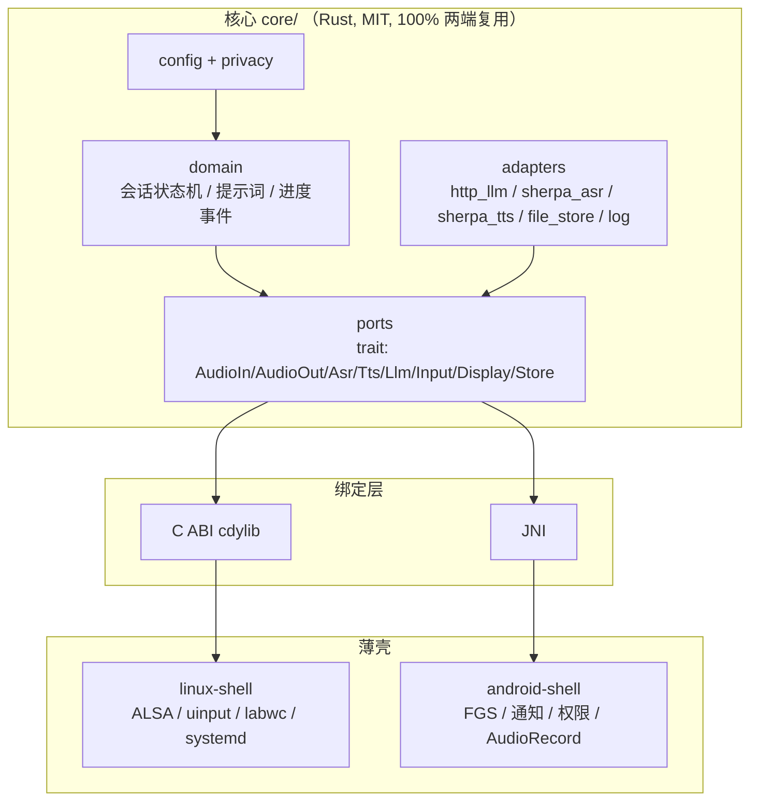

# AD（Advanced Desktop）鼠标形无屏微型计算机 — 设计方案 **v2**

> 版本：v2.0 · 2026-11-06
> 相对 v1 的变更：**主控整条重选（H618 作废）**、新增「开源硬件分层」判定、新增「一套核心 + Linux/Android 双端」软件架构、取消电池、新增外壳散热设计与手工装配规范、新增版本化文档管理。
> 变更明细见 `docs/CHANGELOG.md`；v1 原文保留在 `docs/v1/`，未删除。
> 本轮：**未采购、未下单、未改动任何站点**。所有价格/供货/许可标注为【询价】【实测】【需核实】。

---

## 0. 结论先行

### 0.1 一句话结论

**能做，但要接受一个硬取舍：真正的板级开源硬件（L1）里，没有一块既小到能塞进鼠标壳、又能跑 1080p 桌面、又便宜。三者只能取二。**

### 0.2 三条路线（必须先选一条）

| 路线 | 主控 | 形态 | 出图 | 开源成色 | 单台成本 | 适用 |
|---|---|---|---|---|---|---|
| **α 合规优先（推荐）** | BeaglePlay（AM6254） | 掌托式大鼠标 ≈160×95×45 | **1080p60** | **L1 达标**（OSHW + 板级源文件） | **≈1100 元** | 把「全开源」当硬门槛 |
| **β 形态优先** | BeagleBone Black（AM3358） | 真鼠标 ≈135×80×42 | **720p** 轻量桌面 | **L1 达标**（OSHW 认证） | ≈550 元 | 要"握在手里"的鼠标感 |
| **γ 实用优先** | Milk-V Mars（JH7110） | 真鼠标 ≈135×80×42 | **1080p** | **L1 不达标**（仅原理图 PDF，无 Gerber） | ≈620 元 | 性价比，但放弃硬门槛 |

### 0.3 关键数字（α 路线）

| 项 | 值 |
|---|---|
| 单台手工样品成本 | **≈1100 元**（BeaglePlay 板就占 900） |
| 出图能力 | 1920×1080@60（HDMI Type-A，官方标称 Full-HD） |
| 桌面流畅度 | 4×A53@1.4GHz + 2GB，轻量桌面（labwc + 浏览器）可用，视频 1080p 可解 |
| 语音链路 | 按键说话 → 本地 STT → 云端 LLM → 本地 TTS，首字延迟目标 ≤2.5s |
| 散热目标 | 满载 30min，外壳 ≤45°C，SoC ≤85°C 不降频 |
| 供电 | USB-C 5V/3A，**不带电池** |

### 0.4 必须先讲清的三条真话

1. **L0（开源硅）在可买价位不存在。** OpenHW CORE-V、LowRISC 这类「开放 PDK + 寄存器文档」的路线，要么是几千美元的评估套件、要么根本没有成品板，而且**没有 GPU/HDMI 输出**。所以本产品**不可能做到 L0**，最高只能到 L1。这是结论，不是偷懒。
2. **BeaglePlay 也是 TI 的闭源硅。** L1 指的是「板级设计与文档全开源」，硅本身仍专有。谁跟你说「整机全开源到晶体管」，那是骗你。
3. **鼠标形态与 L1 是天然冲突的。** 满足 L1 的板子最小是 BBB 的 86×53（性能弱）、最大是 BeaglePlay 的 ~89×70（性能够但壳必须大）。想两头都要，只能走 γ，而 γ 不达 L1。

---

## 1. 开源硬件分层（这是本方案能否站住的关键）

### 1.1 四层定义与判定

| 层 | 定义 | 判据（同时满足） | 现实可买性 | 本产品可用？ |
|---|---|---|---|---|
| **L0 开源硅** | 开放 PDK、开放寄存器文档、开放 RTL，可自行流片或买开放硅 | ① 寄存器文档公开 ② RTL/PDK 开放 ③ 有成品板可买 ④ 有 HDMI/GPU | ❌ 几乎无成品；有成品也无 GPU/HDMI | **❌ 不存在** |
| **L1 板级全开源** | ISA 可闭源，但**板级设计全开源**：原理图源文件 + PCB + Gerber + BOM + 许可证 | ① 可编辑源文件 ② Gerber ③ OSHW 认证或 CERN-OHL ④ 能买到 | ✅ 少数（Beagle 系） | **✅ 目标层** |
| **L2 仅 ISA 开、板级闭源** | 只公开原理图 PDF 或只公开 ISA | 缺 Gerber/可编辑源 | ✅ 很多（Milk-V、Sipeed） | ⚠️ 不达标 |
| **L3 完全专有** | 无原理图、无文档、闭源固件 | — | ✅ 最多（电视棒、盒子） | ❌ 已淘汰 |

### 1.2 逐个候选核实结果

| 候选 | 板级源文件 | Gerber | 许可证/认证 | 尺寸 | HDMI | 价格 | 层级判定 |
|---|---|---|---|---|---|---|---|
| **BeaglePlay** | ✅ OpenBeagle 仓库含板级文件 + 3D 模型 | ✅（仓库内） | OSHW 认证；BeagleBoard.org 开源设计 | ≈89×70mm【实测】 | ✅ HDMI Type-A，Full-HD | ¥850–1100【询价】 | **L1** |
| **BeagleBone Black** | ✅ 原理图/装配图/BOM 公开 | ✅ | OSHW 认证（板上有 OSHW 标） | 86.36×53.34mm | ✅ micro HDMI（经 TDA19988），1080p | ¥400–500【询价】 | **L1** |
| **BeagleV-Fire** | ✅ | ✅ | OSHW | — | ❌ **无显示输出** | ¥900+ | 淘汰（无 HDMI） |
| **Milk-V Mars** | ⚠️ 仅原理图 PDF + 2D 尺寸 | ❌ 未公开 | 无 OSHW 认证 | 85×56mm | ✅ HDMI 2.0（4K30） | ¥350–500【询价】 | **L2/L1.5** |
| **Milk-V Jupiter** | ⚠️ 原理图 PDF | ❌ | 无 | 170×170（ITX） | ✅ | ¥700+ | 淘汰（太大） |
| **Lichee Pi 4A（TH1520）** | ⚠️ 原理图 PDF | ❌ | 无 | ≈120×80 | ✅ | ¥550–800 | L2 + 尺寸偏大 |
| **SiFive HiFive 系** | ⚠️ 部分 | ❌ | — | 大 | ❌ 多数无 HDMI | ¥3000+ | 淘汰（价格/显示） |
| **MangoPi MQ-Quad（H616）** | ⚠️ | ❌ | 无 | 65×30 | ✅ | ¥80–120 | L2/L3，已随 v1 淘汰 |

> **结论：真正满足 L1 且能出图的，只有 BeaglePlay 与 BeagleBone Black 两块。** 其余要么无 HDMI、要么无 Gerber、要么太贵/太大。

### 1.3 L0 为什么直接判死（给依据，不含糊）

- **OpenHW CORE-V**：有 CORE-V MCU DevKit（≈$300+，无 GPU、无 HDMI，只有 Arduino 形态的 MCU 板），CVA6 应用级核心**没有可买的成品 SBC**。
- **LowRISC / OpenTitan**：安全芯片方向，不做应用处理器板。
- **PULP / ESP32-C 系**：MCU 级，跑不了 Linux 桌面。
- 共同硬伤：**没有商用 GPU + HDMI PHY 的开源实现**。视频输出这一条就堵死了。
- 所以：**L0 在 1000 元价位、带 HDMI 的前提下，确定不存在。** 本项目天花板 = L1。

---

## 2. 主控选型（结论 + 性能代价）

### 2.1 首选：BeaglePlay（α 路线）

| 项 | 参数 |
|---|---|
| SoC | TI AM6254，4×Cortex-A53 @1.4GHz + PRU + M4F |
| 内存/存储 | 2GB DDR4 / 16GB eMMC |
| 显示 | **HDMI Type-A，最高 Full-HD 1080p**（原生，无桥接） |
| USB | 1× USB-A Host + 1× USB-C（供电 + 数据/串口） |
| 网络 | 千兆以太网 + 2.4/5GHz WiFi + BLE（**板载，不用另买模组**） |
| 扩展 | mikroBUS / Grove / QWIIC（I2C/SPI/UART 现成，接线极省事） |
| 开源 | OpenBeagle GitLab 仓库：原理图、PCB、Gerber、3D 模型、BOM |
| 认证 | OSHW（板上有 OSHW 标识） |
| 尺寸 | ≈89×70mm【实测确认】 |
| 价格 | 官方 $99；国内 ¥850–1100【询价】 |

**选它的理由（按权重）：**
1. **唯一同时满足「L1 + 原生 HDMI 1080p + 板载 WiFi + 4 核」的板子**。BBB 有 L1 没性能，Mars 有性能没 L1。
2. 板载 WiFi/BT，省掉「M.2 模组另买 + 驱动 + 天线」这一整串麻烦（Mars 就要另配）。
3. Grove/QWIIC 是 **JST-SH 1.0mm** 连接器 —— 虽是 1.0mm，但**是成品线缆即插即用，不需要焊接**，符合"手工友好"（禁的是 0.5mm FPC 手焊，不是成品线）。
4. TI 的主线内核支持是几家里面最好的，长期维护风险低。
5. 官方文档质量高（docs.beagleboard.org 有完整的 Design/Expansion/Quick Start）。

**必须如实说的性能代价：**
- **只有 1 个 USB-A Host** → 必须外挂 USB Hub（声卡 + 键盘 + 兜底鼠标模块要 3 个口）。
- **板上没有 3.5mm 音频座、没有板载麦克风** → 音频必须走 USB 声卡（本来也是我们的方案）。
- **壳必须做大**：89×70 的板 + 喇叭腔 + 散热，最终外形 ≈160×95×45，重约 400g。**这不是"握在手里的鼠标"，是"掌心搭着的掌托式指针设备"**。手感要重新定义，不要骗自己。
- 编译/启动比 ARM 商用板慢（首次编译内核 40–90 分钟级）【实测】。

### 2.2 备选 A：BeagleBone Black（β 路线，形态优先）

- 86.36×53.34mm，**能塞进 135×80×42 的真鼠标壳**（内腔宽 ≈62–70mm，勉强够）。
- OSHW 认证，原理图/Gerber/BOM 全公开，资料最"教科书"。
- **代价很硬**：
  - AM3358 单核 A8 @1GHz + 512MB → **只能 720p 轻量桌面**，浏览器多标签会卡；视频 1080p 解码吃力。
  - 无板载 WiFi → 必须插 USB WiFi 网卡（再占一个 USB 口 → 必用 Hub）。
  - 本地 STT 基本跑不动（单核 A8），只能走云端 STT。
- 适合：把"鼠标手感"和"开源合规"看得比性能重，且能接受全程联网。

### 2.3 备选 B：Milk-V Mars（γ 路线，实用优先，但**不达 L1**）

- 85×56mm，与 v1 的 Zero 3 同尺寸，**真鼠标壳可行**。
- JH7110 4×U74 @1.5GHz，1–8GB，HDMI 2.0，3×USB3 + 1×USB2，千兆网。
- **短板**：
  - 官方只公开**原理图 PDF + 2D 尺寸**，**没有 Gerber、没有可编辑 PCB 源** → 严格判为 L1.5/L2，**不满足用户的硬门槛**。
  - WiFi 需另配 M.2 E-Key 模组（+40–60 元）。
  - RISC-V 生态（浏览器硬解、部分软件包）不如 ARM 顺。
- 定位：如果用户松口"Gerber 可以没有，但原理图必须公开"，这是**性价比最高**的一条。

### 2.4 淘汰清单（含理由）

| 淘汰对象 | 理由 |
|---|---|
| 全志 H618 / Orange Pi Zero 3（v1 首选） | 板级只有原理图 PDF，**无 PCB 源文件/Gerber 公开**；SoC datasheet 需 NDA → 不达 L1 |
| 全志 H616 / MangoPi | 同上 |
| 瑞芯微 RV1106 / Luckfox | 无 HDMI，且板级不开源 |
| Milk-V Duo / CV1800B | 无 HDMI |
| Lichee Pi 4A | 仅原理图 PDF；尺寸偏大；价格高 |
| 电视棒/盒子拆板 | L3，闭源 + 签名 + 供货灰色 |
| 树莓派 | 用户明确排除；且板级不开源（只给 PDF） |
| SiFive HiFive | 价格 3000+，多数无 HDMI |

---

## 3. 板级许可证标注

### 3.1 三层标注法

| 载体 | 标注内容 | 位置 |
|---|---|---|
| **成品板（BeaglePlay/BBB）** | 保留原有 OSHW 标识与 BeagleBoard 版权丝印，**不得覆盖、不得磨掉** | 原板 |
| **自研底板（Carrier-Lite）** | 丝印：`AD Carrier v1.0` + `CERN-OHL-S-2.0` + `OSHW` 图形标 + 仓库 URL + 版本号 | 板正面左下角 |
| **外壳** | 内壁激光/贴纸：`CC-BY-SA-4.0` + 项目 URL | 内壁（不破坏外观） |
| **文档/固件** | LICENSE 文件 + 文件头 SPDX 标识（`SPDX-License-Identifier: CERN-OHL-S-2.0` / `MIT`） | 仓库根目录 |

### 3.2 OSHW 标识使用规则

- OSHW 认证标记（齿轮 logo）**只能用于通过 OSHW 认证的设计**。我们自研底板若未走 OSHW 认证流程，**不能**直接印 OSHW 齿轮标，只能印 `CERN-OHL-S-2.0` 文字 + 自建的开源声明。
- 若要正式挂 OSHW 标：需按 OSHW Definition 1.0 提交文档（原理图、PCB、BOM、装配说明、许可证），审核通过后可用。**这条建议放到 v3，MVP 阶段不折腾。**
- BeaglePlay 板上的 OSHW 标是 BeagleBoard 的，我们**照原样保留**即可。

---

## 4. 形态与结构（因 L1 板尺寸被迫调整）

### 4.1 形态决策

| 路线 | 外形尺寸 | 重量 | 握持方式 | 说明 |
|---|---|---|---|---|
| α（BeaglePlay） | **160 × 95 × 45 mm** | ≈400g | 掌心搭放，拇指操作侧键 | 掌托式指针设备，桌面为主 |
| β（BBB） | 135 × 80 × 42 mm | ≈260g | 正常抓握 | 真鼠标手感 |
| γ（Mars） | 138 × 82 × 42 mm | ≈270g | 正常抓握 | 真鼠标手感 |

**α 必须接受的事实**：160mm 长的东西握不住，用户会把它当"掌心托着的小主机"。这不是设计缺陷，是 L1 板尺寸决定的物理约束。**建议在 α 的外壳上做一条 25mm 宽的拇指托与腕托过渡**，让它"像鼠标一样用"而不是"像鼠标一样握"。

### 4.2 内部堆叠（α 路线，自上而下）

```
┌──────────────── 上盖（PETG，含拇指托） ────────────────┐
│  [麦克风孔 φ1.5]        [PTT 键]      [左/中/右 微动]   │
├─────────────────────────────────────────────────────────┤
│  ① 铝散热片 25×25×10（贴 AM6254，鳍片垂直）              │
│  ② BeaglePlay 主板 89×70（四角尼龙柱 M2.5 固定）         │
│  ③ 底板 Carrier-Lite（电源保护 + USB Hub + 排针）        │
│  ④ 喇叭腔（独立，≥2cc）+ 28mm 喇叭（朝下）               │
│  ⑤ 光学腔（前端 1/3）+ PMW3389 + LM19-LSI                │
├──────────────── 下壳（PETG + 1.5mm 铝底板）─────────────┤
│  [光学窗口 φ9]  [喇叭出音孔阵列]  [进风孔]  [4×脚贴]    │
└─────────────────────────────────────────────────────────┘
```

### 4.3 关键尺寸约束（设计时的硬线）

| 约束 | 值 | 来源 |
|---|---|---|
| 主板外形 | 89 × 70 × 1.6mm | BeaglePlay 实测 |
| 主板安装孔 | 4×φ3.0，孔距按官方 2D 图 | 官方 |
| 喇叭后腔容积 | **≥2cc**（28mm 喇叭） | 声学经验值，低于此低频全无 |
| 光学窗口 | φ9mm，距前端 25–35mm | 透镜视场 |
| 透镜工作面离地 | **2.0 ± 0.1mm** | LM19-LSI 规格 |
| 散热片上方净空 | ≥6mm | 对流 |
| 底脚高度 | ≥3mm（保证进气） | 散热 |
| 壁厚 | 2.0mm（PETG） | 强度/打印 |

---

## 5. 显示接口

**只用原生 HDMI，不做 MIPI→HDMI 桥接。** 理由与 v1 相同（桥接需 QFN-64 手焊 + 1080p 上限 + EDID/HDCP 自调），且 BeaglePlay/BBB 都已原生带 HDMI。

| 项 | α（BeaglePlay） | β（BBB） | γ（Mars） |
|---|---|---|---|
| 接口 | HDMI Type-A（标准口，最结实） | micro HDMI（易损） | HDMI（标准口） |
| 分辨率 | 1080p60 | 1080p60（实际建议 720p） | 1080p60 |
| EDID/热插拔 | 内核 DRM 处理 | 同 | 同 |
| 供电 | 显示器不自供电，AD 独立 5V | 同 | 同 |

- **UI 基线定 1280×720**，允许运行时切 1080p。理由：720p 在 α/β/γ 三块板上都稳，且 720p 下 UI 元素更大、更适合"离屏 1.5m 看电视"的场景。
- **micro HDMI（β 路线）必须做应力释放**：壳内做卡扣 + 15cm 短线转接到标准 HDMI 母座。
- 便携屏供电：5V/3A 电源 → USB-C 一分二 → 一路 AD、一路屏。**不要指望 HDMI 取电。**

---

## 6. 光标功能

### 6.1 实现路径（与 v1 一致，已验证思路可行）

```
PMW3389 (SPI, 4线) ──► /dev/spidevX.Y ──► ad-moused (Rust, MIT)
                                              │  读 motion burst ΔX/ΔY
                                              │  CPI 换算 / 1:1 直通
                                              ▼
                                        /dev/uinput
                                     REL_X / REL_Y / BTN_*
                                              ▼
                                    libinput → labwc/sway → 屏幕光标
```

- **为什么走 uinput**：这是 Linux 唯一用户态注入输入事件的标准接口，无需改内核、无需 root（udev 规则即可）。
- **为什么不做 USB HID 从设备**：BeaglePlay 的 USB-C 是 client/供电口，做主设备要额外 gadget 配置；更关键的是语义歧义——AD 自己就是电脑，光标该出现在**自己的 HDMI 屏**上。
- **若真要接别人电脑当鼠标**：加物理拨动开关，旁路一颗 ESP32-S3（USB HID），开关同时切 SPI 的 CS 与供电，两条路径永不同时占用总线。**v3 再做，MVP 不做。**

### 6.2 按键映射

| 物理键 | uinput 事件 | 备注 |
|---|---|---|
| 左/中/右微动 | `BTN_LEFT` / `BTN_MIDDLE` / `BTN_RIGHT` | 标准 |
| PTT（拇指位） | `KEY_F13`（自定义） | 不占用系统键位，避免误触发 |
| 侧键 ×2 | `BTN_SIDE` / `BTN_EXTRA` | |

---

## 7. 光学取光（按其指示：买配套件）

### 7.1 配套件选型

| 型号 | 传感器 + 透镜 | 接口 | 焊接 | 价位【询价】 | 备注 |
|---|---|---|---|---|---|
| **PMW3389DM-T3QU + LM19-LSI** | 16000 CPI | SPI 4 线 | DIP 式 16 脚，**可手焊** | 40–60 元 | **首选**，社区驱动成熟 |
| PAW3395DM-T6QU + L0AE-LSI | 26000 CPI | 私有 SPI | DIP 16 脚 | 55–100 元 | 性能过剩，寄存器需 NDA |
| ADNS-9800 + ADNS-6190 | 8200 CPI | SPI（协议公开） | DIP | 80–150 元 | 文档最全，停产偏贵 |

> **采购要点**：一定要买"**芯片 + 配套透镜**"的套装（卖家通常标"可配套 LM19-LSI 透镜"），不要只买芯片。4 元的"原装"多为翻新片，**选 40 元档并买 2 颗**。

### 7.2 安装高度与公差控制

| 项 | 值 | 控制方法 |
|---|---|---|
| 透镜工作面到桌面 | **2.0 ± 0.1mm** | ① 3D 打印下壳做**限位台阶**（硬限位，不靠手感）；② 光学腔与下壳之间加 **0.1mm 垫片（PET 薄膜）**微调；③ 用塞尺/游标卡尺实测 |
| 传感器与透镜同轴度 | ±0.15mm | 打印件做**定位柱 + 卡槽**，不允许仅靠热熔胶定位 |
| 遮光 | 必须有 | 光学腔单独做黑色内壁（黑色 PETG 或贴消光绒布），防环境光串入 |
| 防尘 | 必须有 | 窗口外侧贴 0.1mm 防尘毛毡圈，不影响光路 |

### 7.3 P0 / P1 切换判据

| 阶段 | 方案 | 进入下一阶段的条件 |
|---|---|---|
| **P0** | 拆一只 9.9 元有线 USB 鼠标的**整块 PCB**（含传感器+透镜+LED+光路+USB 线），插到 AD 的 USB 口 | 光标能动即可进入 P0 其余验证（不阻塞） |
| **P1** | 换 PMW3389 配套件 + 自研光学腔 | **24.5 小时内**做到：25.4mm 位移 = 1000±30 counts 且静止 10s 抖动 <3 counts |
| 熔断 | 若 P1 超时未达标 | **回退 P0**（内嵌 USB 鼠标模块），继续推进后面阶段，把光学留到 v3 |

> 熔断规则是硬性的。光学是整个项目唯一"参数算不出来、只能实物调"的部分，不能让它拖死整机。

---

## 8. 音频链路

### 8.1 选型：USB 声卡（两端统一）

| 方案 | 器件 | 成本 | 可行性 | 结论 |
|---|---|---|---|---|
| **USB 声卡** | CM108 模块（UAC 1.0，免驱） | 12–16 元 | Linux/Android 均免驱；手机 OTG 也能用 | **选它** |
| I2S 直连 | INMP441 + MAX98357A | 15–25 元 | 需 SoC I2S 引脚；BeaglePlay 的 I2S 未引到 2.54 排针，**必须焊细间距焊盘** | 不选 |
| 模拟输入（板载 codec） | — | — | BeaglePlay 无音频座 | 不可用 |

**为什么两端都走 USB**：手机（Android）本身就是 USB Host（OTG），插同一块 USB 声卡即可；Linux 端也是。**一套音频硬件，两端通用**，这正是"一套核心两端外壳"的物理基础。

### 8.2 参数与工程要点

| 项 | 值/结论 |
|---|---|
| 采集 | 16kHz / 16bit / 单声道（STT 标准输入） |
| 播放 | 48kHz / 16bit（声卡原生），软件重采样到模型所需 |
| 功放 | PAM8403（3W，D 类，效率高、发热小） |
| 喇叭 | 28mm 8Ω 2W，独立后腔 ≥2cc |
| AEC | **PTT 模式不需要**；做"免按键常听"才需要（`webrtc-audio-processing`，BSD-3） |
| 防啸叫 | 麦克风朝上/前，喇叭朝下/后；不同腔体；软件限幅；PTT 门控 |
| 底噪对策 | 麦克风走线 <3cm + 屏蔽；采集增益不拉满；软件 `highpass=80Hz` + 噪声门 |

---

## 9. 供电（初代只用 USB，无电池）

### 9.1 电源树

```
USB-C 5V/3A ──► PTC 自恢复保险丝 3A ──► 磁珠 ──► 470µF ──► 板卡 VBUS
                    │
                    └─► USBLC6-2SC6 (ESD, VBUS/D+/D-)
                              │
                              ├──► BeaglePlay (5V, 峰值 1.2A)
                              ├──► USB Hub (0.3A)
                              ├──► USB 声卡 (0.1A)
                              └──► PAM8403 功放 (峰值 1.0A @3W)
```

### 9.2 电流预算

| 负载 | 典型 | 峰值 |
|---|---|---|
| BeaglePlay（SoC + DDR + WiFi + HDMI） | 0.6A | 1.2A |
| USB Hub | 0.1A | 0.3A |
| USB 声卡 | 0.08A | 0.1A |
| PAM8403 + 喇叭（3W） | 0.2A | 1.0A |
| 余量/损耗 | 0.2A | 0.4A |
| **合计** | **≈1.2A（6W）** | **≈3.0A（15W）** |

**结论：电源必须 ≥5V/3A（15W）；线材 ≥20AWG；禁止用 5V/1A 手机充电器。**

### 9.3 器件（手焊友好封装）

| 器件 | 型号 | 封装 | 说明 |
|---|---|---|---|
| ESD | USBLC6-2SC6 | SOT-23-6 | 手焊可行（0.95mm 脚距） |
| 保险丝 | PTC 3A/6V（如 MF-R300） | 插件或 1206 | 插件优先 |
| 储能电容 | 470µF/10V 低 ESR | 插件 φ8 | 电解，插件好焊 |
| 高频去耦 | 100nF ×4 | 0805 | |
| 磁珠 | 600Ω@100MHz 3A | 1206 | |

### 9.4 供电不足的判定（现场可测）

| 现象 | 原因 | 判定方法 |
|---|---|---|
| 喇叭一响就重启 | 峰值电流导致 VBUS 塌陷 | USB 电压电流表，峰值时 VBUS <4.75V 即不合格 |
| HDMI 偶发黑屏/闪断 | 电压跌落触发 HDMI PHY 复位 | 同上，同时看 `dmesg` 有无电源告警 |
| WiFi 断连 | WiFi 峰值电流叠加 | 播放音频时 ping 丢包率 >5% |
| USB 设备掉线重连 | Hub 供电不足 | `dmesg` 看 USB disconnect 频率 |
| 键盘/鼠标无响应 | 同上 | — |

**验收线：满负载（视频 + 最大音量）下 VBUS ≥4.75V，连续 10 分钟无重启。**

---

## 10. 散热：从外壳设计解决

### 10.1 材质对比（这是外壳设计的第一决策）

| 材质 | 玻璃化温度 Tg | 长期耐温 | 导热 | 可打印性 | 结论 |
|---|---|---|---|---|---|
| PLA | 55–60°C | ≈50°C | 0.13 W/mK | 最好 | **不合格**（目标表面 45°C 已接近 Tg，夏天必软） |
| **PETG** | 75–80°C | ≈70°C | 0.2 W/mK | 好 | **推荐**（性价比最佳） |
| ABS | 95–105°C | ≈90°C | 0.17 W/mK | 差（翘曲/气味） | 备选 |
| ASA | 100°C | ≈95°C | 0.17 W/mK | 中 | 备选（耐候好） |
| **铝板 1.5mm + 打印框架（混合）** | — | — | **200+ W/mK** | 需激光切割 | **最佳**（下壳铝板兼作散热器） |

### 10.2 推荐方案：PETG 主体 + 1.5mm 铝底板（混合）

- 下壳做成 **1.5mm 铝板（激光切割）+ PETG 打印边框**，铝板直接做大面积散热面；
- 主板通过 **6mm 铜柱 + 导热垫**把热量导到铝底板；
- 铝底板表面温度会比 PETG 低 8–12°C，且能当配重（改善重心）。

### 10.3 开孔策略（含权衡）

| 位置 | 开孔 | 面积占比 | 理由 |
|---|---|---|---|
| **底面（铝板/打印件）** | 进风孔 φ2mm 阵列 | **15%** | 冷空气从底部进，被脚贴抬高 3mm 形成进气通道 |
| **侧面（左右各一条）** | 竖条缝 1.5×12mm ×6 | **10%** | 形成横向对流 |
| **后部（出风）** | 格栅 1.5×15mm ×8 | **12%** | 热空气从后上方排出 |
| **顶面（掌心面）** | **尽量不开或只开小凹槽** | ≤5% | 手心出汗 + 进灰 + 手感差，**不建议大面积格栅** |

> **权衡说明（必须有）**：开孔率越高越凉，但代价是：① 进灰（光学窗口污染 → 光标丢帧）；② 顶面开孔直接毁手感；③ 削弱结构强度（跌落易裂）；④ 喇叭腔若与散热孔连通会破坏声学。**所以顶部不开大格栅，热量走"主板→铜柱→铝底板"的传导路径，而不是靠顶面开孔。**

### 10.4 散热片安装

- 铝散热片 **25×25×10mm**，鳍片**垂直**（沿重力方向，形成烟囱效应）；
- 1.0mm 导热硅胶垫（6W/mK）贴 AM6254；
- 散热片不得与 WiFi 天线重叠（会影响射频）。

### 10.5 验收方法与两级后备

**验收方法：**
1. 环境 25°C，整机满载（1080p 视频 + 每 2 分钟一次语音）；
2. 30 分钟后用红外测温枪测：外壳上表面 5 点、下表面 5 点、出风口；
3. 读 `/sys/class/thermal/thermal_zone*/temp`；
4. 看 `cpufreq` 是否降频（`scaling_cur_freq` 是否低于 max）。

**通过线：外壳任何点 ≤45°C，SoC ≤85°C，无降频。**

**两级后备：**
| 级别 | 措施 | 成本 | 效果预估 |
|---|---|---|---|
| 后备 1 | 开孔率从 37% 提到 50%（底面 +8%、侧面 +5%），脚贴从 3mm 加到 6mm | 0 | −6~8°C |
| 后备 2 | 加 5V 20×20mm 微型风扇（侧向吹散热片），从 USB 5V 取电 | +6 元 / +0.15W / +25dB | −12~15°C |

> 若两级后备都用上仍超标，**说明 α 路线的板选错了**，应退到 β（BBB，功耗低一半）或改成"开放式支架"形态（不封闭）。

---

## 11. 软件架构：一套核心 + 两端外壳

### 11.1 分层



### 11.2 复用率与代价（诚实估算）

| 层 | 估算行数 | 两端复用 | 说明 |
|---|---|---|---|
| core/domain（状态机、提示词、进度） | 2500 | **100%** | 纯逻辑 |
| core/ports（接口定义） | 600 | **100%** | trait |
| core/adapters（HTTP LLM、本地模型 FFI、配置、日志） | 1800 | **90%** | 文件路径/权限有差异 |
| FFI 绑定（C ABI / JNI） | 400 | 0% | 各写各的 |
| 平台音频（ALSA / AudioRecord） | 700 | 0% | 差异最大 |
| UI（Linux 无 UI / Compose） | 1200 | 0% | Android 独有 |
| 生命周期与权限（systemd / FGS） | 700 | 0% | 差异最大 |
| **合计** | **≈7900** | **核心 ≈62%，含绑定 ≈70%** | — |

**结论：按代码量约 70% 复用，但按工时只有约 55% 复用** —— 因为平台层的调试成本远高于代码量占比。Android 的权限/后台/厂商 ROM 适配会吃掉大量时间。

### 11.3 模块清单（可照着写代码）

```
ad/
├─ core/                                  # Rust，平台无关，MIT
│  ├─ Cargo.toml
│  └─ src/
│     ├─ lib.rs                           # 对外导出
│     ├─ config.rs                        # 配置加载/校验/默认值
│     ├─ error.rs                         # 统一错误类型
│     ├─ domain/
│     │   ├─ session.rs                   # 会话状态机
│     │   ├─ state.rs                     # Idle/Listening/Thinking/Speaking/Error
│     │   ├─ prompt.rs                    # 提示词模板与上下文裁剪
│     │   └─ progress.rs                  # 进度事件（STT完成/LLM首token/TTS开始）
│     ├─ ports/
│     │   ├─ audio.rs                     # trait AudioIn / AudioOut
│     │   ├─ asr.rs                       # trait Asr
│     │   ├─ tts.rs                       # trait Tts
│     │   ├─ llm.rs                       # trait Llm（流式）
│     │   ├─ input.rs                     # trait Input（按键/触摸）
│     │   ├─ display.rs                   # trait Display（可选，Android 用）
│     │   └─ store.rs                     # trait Store（配置/历史）
│     ├─ adapters/
│     │   ├─ http_llm.rs                  # OpenAI 兼容 API，流式 SSE
│     │   ├─ sherpa_asr.rs                # sherpa-onnx FFI 封装
│     │   ├─ sherpa_tts.rs                # sherpa-onnx TTS 封装
│     │   ├─ file_store.rs
│     │   └─ log.rs                       # tracing + 脱敏
│     ├─ pipeline.rs                      # 录音→STT→LLM→TTS 主编排
│     └─ ffi.rs                           # C ABI 导出
├─ linux/
│  ├─ Cargo.toml
│  ├─ src/
│  │   ├─ main.rs
│  │   ├─ audio_alsa.rs                   # arecord/aplay 或 alsa crate
│  │   ├─ mouse_uinput.rs                 # 光标注入
│  │   ├─ sensor_pmw3389.rs               # SPI 读位移
│  │   └─ hotkey_evdev.rs                 # PTT 按键
│  └─ systemd/ad-core.service
├─ android/
│  ├─ settings.gradle.kts
│  ├─ app/
│  │   ├─ build.gradle.kts
│  │   └─ src/main/
│  │      ├─ AndroidManifest.xml
│  │      └─ java/com/ad/desktop/
│  │         ├─ AdService.kt              # 前台服务 + 常驻通知
│  │         ├─ AudioEngine.kt            # AudioRecord / AudioTrack
│  │         ├─ CoreBridge.kt             # JNI 封装 core
│  │         ├─ BootReceiver.kt           # 开机自启（可选）
│  │         ├─ ui/MainActivity.kt        # Compose，亮屏时用
│  │         └─ ui/SettingsScreen.kt      # 配置 LLM/模型/权限
│  └─ jni/                                # Rust cdylib 产物 + CMake
├─ tools/
│  ├─ fetch_models.sh                     # 下载 STT/TTS 模型
│  └─ bench_latency.py                    # 端到端延迟测量
└─ docs/
```

### 11.4 接口定义（C ABI，两端共用）

```c
typedef struct AdCallbacks {
    void (*on_event)(const char* json, void* user);   // 状态/部分文本/进度
    void (*on_pcm)(const int16_t* pcm, int frames, int rate, void* user); // TTS 音频
} AdCallbacks;

AdHandle* ad_core_new(const char* config_json, AdCallbacks cb, void* user);
int  ad_core_start_listen(AdHandle*);
int  ad_core_push_pcm(AdHandle*, const int16_t* pcm, int frames, int rate);
int  ad_core_end_listen(AdHandle*);
int  ad_core_cancel(AdHandle*);
int  ad_core_set_mode(AdHandle*, int mode);  // 0=auto 1=cloud 2=local
int  ad_core_get_state(AdHandle*);
void ad_core_free(AdHandle*);
```

事件 JSON 示例：
```json
{"type":"state","state":"listening"}
{"type":"partial","text":"今天天气"}
{"type":"reply_delta","text":"南京"}
{"type":"progress","stage":"tts_start","ms":1830}
{"type":"error","code":"NET_TIMEOUT","fallback":"local"}
```

### 11.5 配置项

| Key | 默认 | 说明 |
|---|---|---|
| `llm.endpoint` | 空 | OpenAI 兼容地址（可填本地 ollama） |
| `llm.model` | `qwen2.5-7b-instruct` | 模型名 |
| `llm.api_key` | — | **存系统钥匙串/Keystore，不写明文配置** |
| `llm.timeout_ms` | 8000 | 超时切本地 |
| `asr.engine` | `sherpa` | `sherpa` / `cloud` |
| `asr.model_dir` | `~/.ad/models/asr` | |
| `tts.engine` | `sherpa` | |
| `tts.model_dir` | `~/.ad/models/tts` | |
| `audio.input_device` | `default` | ALSA 设备名 / Android 自动 |
| `audio.sample_rate` | 16000 | 采集 |
| `privacy.keep_audio` | `false` | 是否保留录音（默认不保留） |
| `privacy.upload_audio` | `false` | 是否允许上传原始音频（默认只发文本） |
| `privacy.telemetry` | `false` | 默认关闭 |
| `ui.locale` | `zh-CN` | |
| `input.ptt_key` | `KEY_F13` | Linux 键码 |

### 11.6 日志与隐私

| 规则 | 实现 |
|---|---|
| 录音默认**只存内存**，STT 完成后立即清零 | `zeroize` 清零缓冲区 |
| **原始音频不上传**（除非显式开启 `upload_audio`） | 云端只发 STT 后的文本 |
| 日志不含音频、不含完整 prompt | 只记长度、耗时、状态码 |
| 日志脱敏 | 用户文本只记前 12 字 + 哈希 |
| 本地历史可关闭 | `store.history=false` 时纯内存 |
| 权限最小化 | Android 只要 RECORD_AUDIO / POST_NOTIFICATIONS / FOREGROUND_SERVICE，不要通讯录/位置/存储 |

---

## 12. Android 端：息屏可用（这是第二个技术重点）

### 12.1 必需清单（Android 14 / API 34）

| 项 | 内容 |
|---|---|
| 权限 | `RECORD_AUDIO`、`POST_NOTIFICATIONS`（运行时）、`FOREGROUND_SERVICE`、**`FOREGROUND_SERVICE_MICROPHONE`**、`WAKE_LOCK`、`INTERNET` |
| 服务声明 | `android:foregroundServiceType="microphone"` |
| 启动方式 | **必须从可见 Activity 或通知动作启动**（Android 14 禁止后台直接启麦克风型 FGS） |
| 常驻通知 | 渠道 `ad_service`（低重要性）+ 停止按钮 + PTT 按钮（`PendingIntent`） |
| 电池优化 | 引导用户加入白名单（`ACTION_REQUEST_IGNORE_BATTERY_OPTIMIZATIONS`，应用商店政策敏感，内测可用） |
| 保活 | `startForeground()` 必须在 5s 内调用；`WakeLock` PARTIAL 仅在录音时持有 |

### 12.2 唤醒方式三选一（含取舍）

| 方式 | 可靠性 | 功耗 | 息屏可用 | 结论 |
|---|---|---|---|---|
| **蓝牙耳机按键 / 音量键 / 通知栏按钮** | **高** | 极低 | ✅ | **选它** |
| 屏幕点击 | 高 | 中 | ❌（需亮屏） | 亮屏场景补充 |
| 唤醒词（openWakeWord） | 低 | 高（常开麦） | ⚠️ 极易被厂商 ROM 杀 | 不选 |

**为什么唤醒词不选**：① Android 14 的"使用中权限"限制使后台常开麦极难合规；② 各厂商 ROM 会在息屏后 10–30 分钟杀掉后台录音；③ 常开麦耗电，手机端不可接受。

### 12.3 各厂商 ROM 应对（必须写进"首次启动引导页"）

| 厂商 | 设置路径 | 关键项 |
|---|---|---|
| 小米 / Redmi（MIUI/HyperOS） | 设置 → 应用 → 自启动；省电策略 | 开自启动 + 省电策略"无限制" + 锁定后台 |
| 华为 / 荣耀（EMUI/HarmonyOS） | 应用启动管理 | 改为"手动管理"，三个开关全开 |
| OPPO / 一加（ColorOS） | 电池 → 应用耗电管理 | 允许后台活动 + 允许自启动 |
| vivo / iQOO（OriginOS） | 电池 → 后台耗电管理 | 允许后台高耗电 + 自启动 |
| 三星（One UI） | 电池 → 后台使用限制 | 加入"从未休眠的应用" |
| 原生 Android | 电池优化 | 不受限制 |

**引导页做法**：首次启动检测厂商（`Build.MANUFACTURER`），直接跳到对应设置页（Intent），并给截图说明。**不这么做，用户会以为"软件坏了"，实际是被 ROM 杀了。**

### 12.4 手机作为 AD 的价值定位

- 手机屏幕**是可选件**：息屏 = 纯语音终端（放口袋/车载支架）；亮屏 = 带 UI 的助手。
- 好处：**软件零成本验证**。在买 BeaglePlay 之前，先用手机把整条语音链路跑通，能省掉大量硬件调试时间。
- 这也意味着产品逻辑要抽象：**"AD 是一套软件 + 一个外壳"**，硬件只是外壳之一。

---

## 13. 许可证清单（逐项，不笼统说"都是 MIT"）

### 13.1 可以直接用于商用闭源/开源的（宽松许可）

| 组件 | 许可证 | 义务 | 商用免费 |
|---|---|---|---|
| 自研 Rust 核心 | **MIT**（我们定） | 保留版权声明 | ✅ |
| Kotlin / KotlinX | Apache-2.0 | 保留 NOTICE | ✅ |
| Jetpack Compose / AndroidX | Apache-2.0 | 同上 | ✅ |
| sherpa-onnx（STT + TTS 引擎） | **Apache-2.0** | 保留 NOTICE + 专利授权条款 | ✅ |
| ONNX Runtime | MIT | 保留声明 | ✅ |
| llama.cpp | MIT | 同上 | ✅ |
| whisper.cpp | MIT | 同上 | ✅ |
| Rust 依赖（tokio/serde/reqwest 等） | MIT 或 Apache-2.0 | 同上 | ✅ |
| uinput / Linux 输入子系统 | 内核接口，无许可问题 | — | ✅ |
| openWakeWord（若用） | Apache-2.0 | — | ✅（但本方案不用） |

### 13.2 需要留意义务的（弱 copyleft / 文件级）

| 组件 | 许可证 | 义务 | 影响 |
|---|---|---|---|
| **UniFFI**（若用它做绑定） | **MPL-2.0** | 仅"修改过的 MPL 文件"需开源；链接不传染 | 可用，但改它就要开源那个文件 |
| ALSA lib | LGPL-2.1 | 动态链接即可，静态链接需提供目标文件 | 注意别静态链 |
| glibc | LGPL-2.1 | 同上 | 同上 |

### 13.3 会引入强 copyleft 的（**这是最容易踩的坑**）

| 组件 | 许可证 | 触发条件 | 建议 |
|---|---|---|---|
| **Linux 内核 / BSP** | **GPL-2.0-only** | 分发二进制 | 必须提供完整源码（含补丁 + .config + 构建脚本） |
| U-Boot | GPL-2.0+ | 同上 | 同上 |
| **espeak-ng（piper 的依赖）** | **GPL-3.0** | **与 piper 链接后整体受 GPL-3.0** | **不要用 piper**，改用 sherpa-onnx TTS |
| **FFmpeg（`--enable-gpl` 构建）** | **GPL-2.0+** | 分发 | Android 端**不用 FFmpeg**，用 AudioRecord/MediaCodec |
| FFmpeg（默认构建） | LGPL-2.1+ | 动态链接 + 可替换 | 如必须用，走 LGPL 构建 |
| alsa-utils（`arecord/aplay`） | GPL-2.0 | 独立进程调用 = 聚合，不传染 | 可用（进程隔离） |

> **关键结论**：**piper 看起来很香（MIT），但它依赖 espeak-ng（GPL-3.0），链接后你的整个程序就变成 GPL-3.0。** 想"商用免费且能闭源"，必须用 **sherpa-onnx 的 VITS TTS**（Apache-2.0，不需要 espeak-ng）。这一条足以改变技术选型。

### 13.4 平台方闭源组件（要如实告知）

| 组件 | 情况 | 对策 |
|---|---|---|
| Google TTS / Android `SpeechRecognizer` | **闭源**，依赖 Google Play 服务，离线不保证 | **不用**，用 sherpa-onnx 本地引擎 |
| 各厂商语音助手 SDK | 闭源 + 商用授权限制 | 不用 |
| AW859A / TI WiFi 固件 | 二进制 blob，可再分发不可改 | 随镜像分发，说明来源 |
| Mali / PowerVR GPU 驱动 | 专有二进制 | 同上 |
| HDMI 商标与规范 | HDMI LA 授权（年费 + 每台权利金） | 小批量自制通常未申报，**法律上需要**，如实告知 |

### 13.5 模型许可证（最容易忽略）

| 模型 | 许可证 | 备注 |
|---|---|---|
| SenseVoice-small | 以仓库 LICENSE 为准【需核实】 | 常见标注 Apache-2.0 |
| Paraformer / FunASR | 以仓库 LICENSE 为准【需核实】 | 常见标注 Apache-2.0 / MIT |
| Whisper（权重） | MIT | 可商用 |
| VITS 中文 TTS（sherpa 版） | 逐模型核实【需核实】 | 常见 Apache-2.0 / CC-BY-4.0 |
| Qwen2.5（0.5B–7B） | **Apache-2.0** | 可商用 |
| Llama 系列 | Llama Community License | **非 OSI 许可**，商用有条件（月活限制），不建议 |

**结论：开源 + 商用免费的完整链路 = sherpa-onnx(Apache-2.0) + Qwen2.5(Apache-2.0) 或任意 OpenAI 兼容 API + 自研 MIT 核心。**

---

## 14. AI 语音通道：两端各一套最小链路

### 14.1 Linux 端（α/β/γ 通用）

```
PTT 按下 → arecord -f S16_LE -r 16000 -c 1 → 能量 VAD 切句
        → sherpa-onnx (SenseVoice-small int8) → 文本
        → HTTP POST /v1/chat/completions (SSE 流式) → 分句
        → sherpa-onnx VITS TTS（流式）→ aplay -r 48000
        → 同时通过 HDMI 上的 UI 显示进度
```

最小依赖（Debian）：
```bash
apt install -y alsa-utils libasound2-dev build-essential
pip3 install sherpa-onnx         # 或下载预编译 wheel
# 模型目录 ~/.ad/models/{asr,tts}
```

### 14.2 Android 端

```
通知/蓝牙键 → AdService(startForeground, type=microphone)
           → AudioRecord(16000, MONO, PCM_16) → VAD
           → CoreBridge → sherpa-onnx AAR（本地 STT）
           → 云端 LLM（或本地 llama.cpp，可选）
           → sherpa-onnx TTS → AudioTrack(48000)
           → 通知栏显示进度；亮屏时 Compose UI 同步
```

- 息屏时**只走通知栏 + 语音**，不渲染 UI（省电）。
- 亮屏时 Compose UI 显示对话流。

### 14.3 本地 / 云端 / 降级

| 模式 | STT | LLM | TTS | 体积占用 | 联网 |
|---|---|---|---|---|---|
| 全云端 | 云端（可选） | 云端 | 云端 | 0 | 必须 |
| **混合（推荐）** | 本地 sherpa | **云端** | 本地 sherpa | 300–500MB | LLM 需网 |
| 全本地 | 本地 sherpa | 本地 llama.cpp + Qwen2.5-0.5B-Q4 | 本地 sherpa | 700MB–1.2GB | 不需要 |

| 降级触发 | 行为 |
|---|---|
| LLM 超时 3s | 切本地 0.5B，语音提示"网络慢，已切本地" |
| 完全离线 | 本地 STT + 规则引擎（时间/计时/记事/开关）+ 本地 TTS，播报"当前离线" |
| 模型缺失 | 提示"未安装语音模型"，HDMI/手机上显示安装指引 |
| 麦克风被占用 | 提示并降级为屏幕输入 |

**性能预期（需实测）**：
- α（BeaglePlay 4×A53）：3 秒语音 STT 0.8–1.8s；本地 TTS 实时倍率 0.4–0.8×。
- β（BBB 单核 A8）：**本地 STT 基本不可用**，必须云端。
- Android（中端机）：STT 0.3–0.8s，TTS 实时倍率 1.5–3×，体验最好。

---

## 15. BOM（两套）

### 15.1 BOM-α 开源合规版（BeaglePlay，推荐）

| # | 类别 | 型号/规格 | 封装 | 数量 | 单价(元) | 小计 | 渠道 |
|---|---|---|---|---|---|---|---|
| 1 | 主控 | **BeaglePlay**（AM6254/2GB/16GB eMMC/WiFi） | 板卡 ≈89×70 | 1 | 900【850–1100 询价】 | 900 | 线上（ARACE/淘宝） |
| 2 | 存储 | microSD 32GB A1 | — | 1 | 20 | 20 | 线下/线上 |
| 3 | 电源 | 5V/3A USB-C 适配器 + 20AWG 线 | — | 1 | 30 | 30 | 线下（金盛/华龙） |
| 4 | 扩展 | USB 2.0 4 口 Hub 模块（带 2.54 排针） | 成品模块 | 1 | 15 | 15 | 线上 |
| 5 | 音频 | CM108 USB 声卡模块（麦+耳机口） | 成品模块 | 1 | 15 | 15 | 线上 |
| 6 | 音频 | 驻极体麦克风 6mm 全指向 | 插件 | 1 | 2 | 2 | 线下 |
| 7 | 音频 | PAM8403 功放板（3W） | 成品板 | 1 | 2.5 | 2.5 | 线下 |
| 8 | 音频 | 喇叭 28mm 8Ω 2W | 插件 | 1 | 5 | 5 | 线下 |
| 9 | 光标 | **PMW3389DM-T3QU + LM19-LSI 透镜套装** | DIP-16 | 2 | 45 | 90 | 线上（买 2 颗） |
| 10 | 光标 | 光学腔定位件（3D 打印 / 成品支架） | — | 1 | 10 | 10 | 自打印 |
| 11 | 输入 | 6×6 轻触开关（左中右+PTT+侧键×2） | 插件 | 5 | 0.3 | 1.5 | 线下 |
| 12 | 散热 | 铝散热片 25×25×10 + 导热垫 1mm(6W/mK) | — | 1 | 5 | 5 | 线下 |
| 13 | 结构 | 铝底板 1.5mm 100×160（激光切割） | — | 1 | 15 | 15 | 线下/线上 |
| 14 | 搭建 | 洞洞板 5×7 + 排针 + 杜邦线 + JST-XH 端子 | — | 1套 | 10 | 10 | 线下 |
| 15 | 保护 | USBLC6-2SC6 + PTC 3A + 470µF + 磁珠 + 100nF | SOT-23-6/1206 | 1套 | 5 | 5 | 线下/线上 |
| 16 | 结构 | 3D 打印 PETG 上盖+边框 ≈160g | — | 1 | 35 | 35 | 外协打印 |
| 17 | 五金 | M2.5 铜柱 + 螺丝 + 脚贴 + 热熔胶 | — | 1套 | 8 | 8 | 线下 |
| — | — | **合计（不含运费/工具）** | — | — | — | **≈1269 元** | — |

> 若把第 9 项减为 1 颗、Hub 用最便宜款、外壳自打印，可压到 **≈1100 元**。

### 15.2 BOM-γ 实用版（Milk-V Mars，真鼠标尺寸，**不达 L1**）

| # | 型号/规格 | 数量 | 单价 | 小计 | 渠道 |
|---|---|---|---|---|---|
| 1 | Milk-V Mars 2GB | 1 | 400【350–500 询价】 | 400 | 线上（淘宝官方店） |
| 2 | M.2 E-Key WiFi/BT 模组（RTL8822CS） | 1 | 45 | 45 | 线上 |
| 3 | microSD 32GB | 1 | 20 | 20 | 线下 |
| 4 | 5V/3A 电源 + 线 | 1 | 25 | 25 | 线下 |
| 5 | USB 2.0 4 口 Hub | 1 | 12 | 12 | 线上 |
| 6 | CM108 USB 声卡 | 1 | 12 | 12 | 线上 |
| 7 | 驻极体麦克风 | 1 | 2 | 2 | 线下 |
| 8 | PAM8403 | 1 | 2.5 | 2.5 | 线下 |
| 9 | 28mm 喇叭 | 1 | 5 | 5 | 线下 |
| 10 | PMW3389 + 透镜 | 2 | 45 | 90 | 线上 |
| 11 | 轻触开关 ×5 | 1 | 1.5 | 1.5 | 线下 |
| 12 | 散热片 + 导热垫 | 1 | 4 | 4 | 线下 |
| 13 | 3D 打印 PETG | 1 | 30 | 30 | 外协 |
| 14 | 五金/线材/保护件 | 1套 | 12 | 12 | 线下 |
| — | **合计** | — | — | **≈661 元** | — |

### 15.3 BOM-β（BBB，真鼠标 + 720p）

≈ 500–560 元（BBB 400–500 + 其余同上）。**无板载 WiFi，需另加 USB WiFi 网卡 25 元。**

### 15.4 成本结论

| 路线 | 手工样品单台 | 说明 |
|---|---|---|
| α | **1100–1300 元** | 板子占 70%，无可压缩空间 |
| β | **500–560 元** | 便宜但性能弱一半 |
| γ | **620–700 元** | 性价比最好，但不达 L1 |
| 小批量 100 台 | α ≈900、γ ≈450【询价】 | 板卡批量折扣有限，结构件摊销明显 |

---

## 16. 采购清单（线上 / 线下分开）

### 16.1 线上（淘宝/阿里系优先）

| # | 名称 | 型号/规格 | 数量 | 单价区间 | 采购地 | 关键路径 | 替代型号 |
|---|---|---|---|---|---|---|---|
| 1 | 主控板 | **BeaglePlay**（或 BBB / Milk-V Mars） | 1 | 900 / 450 / 400 | 淘宝 ARACE 店、BeagleBoard 国内代理 | **★是** | Radxa（不达 L1） |
| 2 | 光学配套件 | **PMW3389DM-T3QU + LM19-LSI** | 2 | 40–60 | 淘宝（选 40 元档，避开 4 元翻新片） | ★是 | PAW3395 + L0AE-LSI（55–100） |
| 3 | USB 声卡模块 | CM108（带 mic in + 3.5mm out） | 2 | 12–18 | 淘宝 | ★是 | SSS1629 模块（略贵、底噪更好） |
| 4 | USB 鼠标模块（兜底） | 9.9 元有线 USB 鼠标 | 2 | 10 | 淘宝/线下 | 否 | 任意有线鼠标 |
| 5 | USB Hub 模块 | 4 口 USB2.0，带 2.54 排针 | 1 | 12–18 | 淘宝 | ★是 | FE1.1s 自制（需贴片） |
| 6 | USB-C 转接 | USB-C 母座转 2.54 / 端子 | 2 | 5 | 淘宝 | 否 | — |
| 7 | 散热片 | 铝 25×25×10 | 2 | 3–5 | 淘宝/线下 | 否 | 20×20×10 |
| 8 | 导热垫 | 1.0mm，6W/mK | 1 | 5 | 淘宝 | 否 | 3M 8810 |
| 9 | 杜邦线/排针 | 母对母 20cm + 单排针 | 1套 | 10 | 淘宝/线下 | 否 | — |
| 10 | 铜柱螺丝 | M2.5 尼龙柱套装 | 1套 | 8 | 淘宝/线下 | 否 | — |
| 11 | microSD | 32GB A1（SanDisk 优先） | 1 | 20 | 淘宝/线下 | ★是 | 三星 EVO |

### 16.2 线下（南京金盛 / 华龙电子城）

| # | 名称 | 规格 | 数量 | 单价区间 | 备注 |
|---|---|---|---|---|---|
| 1 | 喇叭 | 28mm 8Ω 2W | 2 | 4–6 | 试音选一致性好的一对 |
| 2 | 驻极体麦克风 | 6mm 全指向，带引脚 | 5 | 1–2 | 多买几颗挑底噪 |
| 3 | PAM8403 功放板 | 3W 双声道 | 2 | 2–3 | 成品板 |
| 4 | 轻触开关 | 6×6×5 直插 | 10 | 0.2–0.4 | 选手感一致的 |
| 5 | 拨动开关 | 2 档 3 脚（预留模式开关） | 2 | 0.5 | — |
| 6 | 洞洞板 | 5×7cm / 7×9cm | 3 | 2–3 | — |
| 7 | 排针/排母 | 2.54 单排 | 各 5 | 0.5 | — |
| 8 | JST-XH 端子 | 2P/3P/4P 带线 | 各 5 | 1 | 比杜邦线牢 |
| 9 | 电源适配器 | 5V/3A USB-C | 2 | 20–30 | **必须 ≥3A** |
| 10 | 自恢复保险丝 | PTC 3A/6V 插件 | 5 | 0.5 | — |
| 11 | 电解电容 | 470µF/10V 低 ESR | 5 | 0.5 | — |
| 12 | 磁珠 | 600Ω@100MHz 3A | 5 | 0.3 | — |
| 13 | 电阻电容 | 0805 常用值套装 | 1套 | 15 | — |
| 14 | 热缩管/热熔胶/双面胶 | — | 1套 | 15 | 绝缘固定用 |
| 15 | 螺丝/铜柱/脚贴 | M2/M2.5 混装 + PTFE 脚贴 | 1套 | 15 | — |
| 16 | 铝板 | 1.5mm，100×160 | 1 | 15 | 可让店家代剪 |

### 16.3 关键路径（缺一件就开不了工）

**★ 必先到位：主控板、光学配套件、USB 声卡模块、USB Hub、microSD、5V/3A 电源。**
其余（喇叭/开关/洞洞板/五金）可边做边补。

> **现实提醒**：金盛/华龙**买不到**主控板、光学传感器、USB 声卡模块、USB Hub、microSD 高速卡。这几样必须线上，等 2–4 天。南京线下只能解决"通用元件 + 五金 + 线材 + 电源"。

---

## 17. 手工组装（本次重点）

### 17.1 连接器策略（硬规则）

| 允许 | 禁止 | 理由 |
|---|---|---|
| 2.54mm 排针/排母 | 0.5mm FPC 手焊 | 手焊不可能 |
| JST-XH 2.54 / PH2.0 端子 | BGA / QFN<0.65mm | 无返修能力 |
| 凤凰端子（电源） | 0201/0402 元件 | 手抖 |
| Grove / QWIIC 成品线（1.0mm，**插接非焊接**） | 细间距板对板连接器 | — |
| 0805 及以上贴片 | — | 可手焊 |

### 17.2 自焊 vs 委外（明确边界）

| 工作 | 谁做 | 说明 |
|---|---|---|
| 主控板、声卡、Hub、光学芯片本体 | **买成品** | 不自制 |
| 载板上的 0805/1206 阻容、SOT-23-6 ESD | **自己焊** | 可手焊 |
| SOT-23-6 / 1206 以下密集贴装 | 委外（嘉立创 SMT） | 若底板元件 >30 个，建议直接委外，5 元打样 + SMT 起步价 30 元 |
| 排针/端子/开关 | **自己焊** | 2.54 直插 |
| 外壳 | 外协打印 / 自打印 | PETG |
| 飞线 | 自己 | 用 0.3mm 镀锡线 + 热缩管 |

> **建议**：底板（Carrier-Lite）元件数控制在 **≤25 个**，全部选 0805/插件，就能纯手工。一旦需要贴 QFN 或超过 30 个元件，直接交给嘉立创 SMT，**不要硬焊**。

### 17.3 装配顺序与通过标准（摘要，详见 MVP 清单）

| 阶段 | 内容 | 通过标准 |
|---|---|---|
| **S0 来料检查** | 清点、万用表量通断、看板卡外观 | 无误、无短路（VBUS-GND >1kΩ） |
| **S1 裸板点亮** | 只接 5V + HDMI + SD 卡 | **1280×720 桌面出现，稳定 10 分钟无闪屏** |
| **S2 网络与输入** | 连 WiFi、插键鼠 | SSH 可登录；键鼠即插即用 |
| **S3 音频** | 声卡 + 麦克风 + 功放 + 喇叭 | 录音回放清晰；0.3m 处 ≥75dB；无啸叫 |
| **S4 光标兜底** | 内嵌 USB 鼠标模块 | 光标随手移动，无跳变 |
| **S5 光学自研** | PMW3389 + 光学腔 | 25.4mm = 1000±30 counts；静止 10s 抖动 <3 |
| **S6 底板集成** | 电源保护 + Hub + 排针 | 满载 VBUS ≥4.75V；10 分钟无重启 |
| **S7 整机装配** | 装壳、固定、走线 | 无干涉；跌落 1m（可选）不开裂 |
| **S8 热测** | 满载 30 分钟 | 外壳 ≤45°C；SoC ≤85°C；无降频 |
| **S9 语音链路** | STT/LLM/TTS + PTT | 首字延迟 ≤2.5s；离线降级正常 |
| **S10 长跑** | 72 小时 | 无重启；内存增长 <10% |

### 17.4 走线 / 固定 / 绝缘

| 项 | 做法 |
|---|---|
| 电源线 | 20AWG 红黑双绞，走壳内边缘，远离光学腔 |
| 信号线 | SPI 线 ≤10cm，必要时加 100Ω 串阻 |
| 麦克风线 | 屏蔽线，屏蔽层单端接地（靠声卡端） |
| 固定 | 尼龙柱 + M2.5 螺丝；**禁止只用热熔胶承重** |
| 防短路 | 板底贴 0.5mm 绝缘垫（青稞纸/聚酰亚胺胶带） |
| 应力释放 | HDMI/USB-C 线在壳内做 S 型弯 + 扎带固定 |
| 振动 | 喇叭四周加 1mm EVA 泡棉，防共振 |

### 17.5 上电检查点（每次通电前必做）

1. **目视**：无连锡、无元件歪斜、无金属屑；
2. **通断**：万用表二极管档量 VBUS↔GND，**必须 >1kΩ**（短路则 <10Ω）；
3. **极性**：电解电容、二极管方向；
4. **空载上电**：先不接主板，只量底板输出 5V；
5. **限流上电**：用可调电源限流 500mA 首上电，观察电流是否异常；
6. **正常上电**：确认无异常后再全电流。

---

## 18. 图纸交付清单（本轮只给清单与约束，不画完）

### 18.1 交付物清单

| # | 图纸 | 软件 | 格式 | 许可证 | 关键内容 |
|---|---|---|---|---|---|
| 1 | 底板 Carrier-Lite 原理图 | **KiCad 8/9** | `.kicad_sch` + PDF | CERN-OHL-S-2.0 | 电源保护、USB Hub、排针定义、按键、光学 SPI 接口 |
| 2 | 底板 PCB | KiCad 8/9 | `.kicad_pcb` + Gerber + 钻孔 + BOM + CPL | CERN-OHL-S-2.0 | 2 层，1.6mm，元件单面 |
| 3 | 外壳（参数化） | **FreeCAD 1.0** | `.FCStd` + STEP + STL | CC-BY-SA-4.0 | 壁厚/孔位/腔体全参数化，改尺寸只改 5 个数 |
| 4 | 外壳（备选快速版） | **OpenSCAD** | `.scad` + STL | CC-BY-SA-4.0 | 便于用变量快速改尺寸 |
| 5 | 装配爆炸图 | FreeCAD TechDraw | PDF + SVG | CC-BY-SA-4.0 | 标序号，对应 BOM |
| 6 | 接线图 | KiCad 原理图 + Inkscape | PDF + SVG | CERN-OHL-S-2.0 | 每根线从哪到哪、颜色、线径 |
| 7 | 装配说明 | Markdown + 照片 | `.md` | CC-BY-SA-4.0 | 对应 MVP 清单 |
| 8 | 3D 打印参数 | — | `.md` | CC-BY-SA-4.0 | 层高/填充/支撑/朝向 |

### 18.2 底板开源设计约束（硬规则）

1. **2 层板**，1.6mm 厚，元件**单面贴装**，另一面只放丝印；
2. 最小封装 **0805**，不允许 0402/0201；
3. 所有对外接口用 **2.54 排针 / JST-XH / 凤凰端子**；
4. **禁止** 0.5mm FPC、BGA、QFN 脚距 <0.65mm；
5. 电源走线 ≥40mil，地平面完整（底层铺铜）；
6. 丝印必须含：`AD Carrier v1.0`、`CERN-OHL-S-2.0`、仓库 URL、日期、版本；
7. 提供**测试点**（TP_VBUS / TP_GND / TP_5V / TP_SPI_CLK），φ1.5mm 焊盘，方便万用表探针；
8. BOM 中每个元件标注"手焊/委外"。

### 18.3 外壳关键尺寸约束（写进 FreeCAD 变量表）

```
BOARD_L = 89, BOARD_W = 70, BOARD_T = 1.6
SHELL_L = 160, SHELL_W = 95, SHELL_H = 45, WALL = 2.0, R = 12
SPK_D = 28, SPK_CAVITY_CC = 2.5
OPTIC_H = 2.0 ± 0.1, OPTIC_WINDOW_D = 9
HEATSINK = 25x25x10, CLEARANCE = 6
FOOT_H = 3.0
GRILLE_BOTTOM_PCT = 15, GRILLE_SIDE_PCT = 10, GRILLE_REAR_PCT = 12
```

---

## 19. 验收测试清单

| # | 项目 | 方法 | 通过标准 |
|---|---|---|---|
| T1 | 显示 | 开机接 HDMI | 1280×720 出现，10 分钟无闪 |
| T2 | 显示稳定性 | 1080p 连续 8h | 0 次闪断/花屏 |
| T3 | HDMI 热插拔 | 30 次 | 识别率 100% |
| T4 | 光标线性度 | 25.4mm ×10 次 | 1000 ±30 counts |
| T5 | 光标抖动 | 静止 10s | <3 counts |
| T6 | 光标最大速度 | 2 m/s 甩动 | 丢帧 <2% |
| T7 | 麦克风 SNR | 1kHz @94dB SPL | ≥50dB |
| T8 | 麦克风底噪 | 静音录 10s | <−60dBFS |
| T9 | 喇叭响度 | 1kHz，0.3m | ≥75dB SPL |
| T10 | 喇叭失真 | 同上 | THD <5% @85dB |
| T11 | 啸叫 | 最大音量 + 开麦 | 无自激 |
| T12 | 供电 | USB 表测满载 VBUS | ≥4.75V，10 分钟无重启 |
| T13 | 功耗 | 待机 / 满载 | ≤6W / ≤15W |
| T14 | 温度 | 25°C，满载 30min | 外壳 ≤45°C，SoC ≤85°C，无降频 |
| T15 | 语音延迟 | PTT 松开 → 首音频 | ≤2.5s（云）/ ≤4s（本地） |
| T16 | STT 准确率 | 20 条 ×3 次 | ≥85%（静音）/ ≥70%（65dB 噪声） |
| T17 | 离线降级 | 断网 | 3s 内切本地并语音提示 |
| T18 | 长跑 | 72h | 无重启，RSS 增长 <10% |
| T19 | Android 息屏 | 息屏 30 分钟后按键说话 | 正常响应；无被 ROM 杀 |
| T20 | 隐私 | 抓包 | 原始音频不出设备（默认配置） |

---

## 20. 风险与合规

| # | 风险 | 概率 | 影响 | 对策 |
|---|---|---|---|---|
| R1 | **大板 + 喇叭腔 + 散热挤在一个能握的壳里** | 高 | 高 | 先做泡沫 1:1 模型；接受 α 形态放大；铝底板兼散热 |
| R2 | **光学腔安装高度公差（±0.1mm）** | 高 | 高 | 硬限位台阶 + 0.1mm 垫片 + 塞尺实测；P1 超时即熔断回 P0 |
| R3 | 满载过热降频 | 中 | 高 | 铝底板 + 侧面/底部开孔 + 锁频 1.2GHz + 后备风扇 |
| R4 | BeaglePlay 只有 1 个 USB-A | 确定 | 中 | 必用 Hub；Hub 供电单独走 VBUS |
| R5 | 淘宝"原装"传感器是翻新片 | 中 | 中 | 买 40 元档 ×2，先校验 product ID |
| R6 | 5V 峰值掉压重启 | 中 | 中 | 5V/3A + 470µF + 20AWG；验收 T12 |
| R7 | Android 厂商 ROM 息屏杀后台 | 高 | 中 | 首次启动引导 + 白名单 + 通知栏常驻 |
| R8 | **piper 依赖 espeak-ng 引入 GPL-3.0** | 确定 | 高（法律） | 改用 sherpa-onnx TTS |
| R9 | GPL-2.0 源码义务疏漏 | 中 | 高 | 随货提供源码包 + 构建脚本 |
| R10 | HDMI 商标/权利金 | 中 | 中 | 如实告知；正式销售需签 Adopter Agreement |
| R11 | WiFi 认证（SRRC/CE） | 中 | 高 | 小批量自用免；销售必做（1–2 万元）【询价】 |
| R12 | BeaglePlay 国内供货波动 | 中 | 中 | 备 1 块；或退 γ |

**合规要点：**
- 内核 GPL-2.0：随货提供完整源码（补丁 + `.config` + 构建脚本），或书面 offer ≥3 年。
- 自研代码 MIT、底板 CERN-OHL-S、外壳 CC-BY-SA —— 三套许可证**分别标注**，不混用。
- 保留 BeaglePlay 上的 OSHW 标识与版权丝印，不得磨除。
- 若正式销售：SRRC（无线）+ 3C（若涉及适配器）+ HDMI Adopter。

---

## 21. 待拍板决策点（5 个）

| # | 决策 | 选项 | 影响 |
|---|---|---|---|
| **D1** | **主控路线** | **α BeaglePlay**（L1 达标，1080p，¥1100）/ **β BBB**（L1，720p，¥550）/ **γ Milk-V Mars**（不达 L1，1080p，¥660） | 决定形态、性能、合规成色 |
| **D2** | **是否接受"掌托式"形态** | 接受 160×95×45（α）/ 坚持 135×80×42 真鼠标（β 或 γ） | 决定主控只能是 BBB/Mars |
| **D3** | **光学件策略** | 买 PMW3389+透镜配套件自研（推荐）/ 直接内嵌 USB 鼠标模块（最省事） | 决定 BOM 优雅度与风险 |
| **D4** | **Android 端优先级** | 先做 Android（手机零成本验证，2 周内可跑通）/ 先做 Linux 硬件端 | 决定开发顺序 |
| **D5** | **许可证严格度** | 严格（不用 piper/FFmpeg-GPL，全部 Apache/MIT）/ 宽松（可用 GPL 组件但需开源） | 决定 TTS 引擎与最终合规成本 |

---

## 22. 最可能翻车的两处（重申）

**① 结构 + 散热**：α 路线要在 160×95×45 的壳里塞 89×70 的板 + 喇叭后腔 + 散热片 + Hub + 声卡。装得进去是第一步，**30 分钟满载不超过 45°C 才是真考验**。PETG 的 Tg 只有 75–80°C，一旦内部堆积到 70°C，壳会软。缓解只能靠"铝底板传导 + 侧面开孔 + 锁频"，不能靠顶面开格栅（毁手感、进灰）。

**② 光学腔公差**：PMW3389 本身好焊好驱动，难在**透镜到桌面的 2.0±0.1mm** 和**同轴度**。自制塑料件如果只用热熔胶定位，几乎必然出现"慢移正常、快移飘"。必须做硬限位台阶 + 垫片微调 + 塞尺实测，且 P1 超过 24 小时不达标就**强制熔断**回 P0。

---

## 附录 A：参考资料读取结果（如实说明）

| 链接 | 结果 |
|---|---|
| `https://feishu.doubao.com/drive/file/DJfTbpN2Doubgvx4VfTctA9snmg` | ❌ **取不到**。请求返回的是登录页（一张图片），需要飞书账号登录与分享权限。**本文未采纳其中任何内容，也未编造其内容。** 若需参考，请把文件导出为 PDF/Markdown 放到工作目录，我再读取并标注采纳点。 |
| BeaglePlay 官方文档 | ✅ 已核实：AM6254 / 2GB / 16GB eMMC / HDMI Type-A Full-HD / 1×USB-A + 1×USB-C / mikroBUS+Grove+QWIIC / 设计仓库在 OpenBeagle |
| Milk-V Mars 官方页 | ✅ 已核实：JH7110 / 85×56mm / HDMI 2.0 / 3×USB3+1×USB2 / M.2 E-Key WiFi（模组另购）/ 5V@3A |
| Milk-V 硬件文档 | ✅ 已核实：仅公开**原理图 PDF + 2D 尺寸**，未见 Gerber/KiCad 源 |
| BeagleBoard 设计文档 | ✅ 已核实：提供 schematic 下载与设计仓库（板级文件 + 3D 模型） |
| 光学/声卡价格 | ⚠️ 淘宝行情，**需询价** |
| 模型许可证 | ⚠️ 需逐个以仓库 LICENSE 为准 |

## 附录 B：需实测 / 需询价清单

| 项 | 类型 | 说明 |
|---|---|---|
| BeaglePlay 实际外形尺寸与安装孔位 | 实测 | 决定外壳 |
| BeaglePlay 国内现货与价格 | 询价 | 850–1100 波动大 |
| BeaglePlay 满载功耗与 SoC 温度 | 实测 | 决定散热 |
| BBB 720p 桌面实际流畅度 | 实测 | 决定 β 是否可用 |
| Milk-V Mars 2GB 现货价 | 询价 | 350–500 |
| PMW3389 翻新片比例 | 实测 | 买 2 颗对比 |
| CM108 模块 SNR/底噪 | 实测 | <50dB 则换 SSS1629 |
| 各中文 STT/TTS 模型许可证 | 需核实 | 逐仓库 LICENSE |
| 3D 打印 PETG 本地报价 | 询价 | 30–40 元/套 |
| 嘉立创 2 层板 + SMT 起步价 | 询价 | 打样 5 元 + SMT 30 元起 |
| SRRC 认证费用 | 询价 | 1–2 万元，4–8 周 |

---

*v2.0 · 设计评审用 · 未下单、未采购、未改动任何站点*
