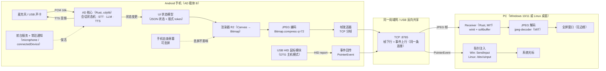
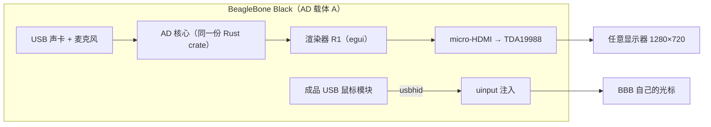

# AD 鼠标形无屏微型计算机 · 设计方案 v4（概念模型修正：AD ≠ 桌面软件）

| 项目 | 内容 |
|---|---|
| 版本 | v4.0 |
| 日期 | 2026-11-06 |
| 状态 | 决策已闭环；**本版只修正「屏幕归属」这一个概念模型**，硬件与许可结论沿用 v3 |
| 取代关系 | 取代 v3 的 §5.1 / §5.3 / §5.4（三端外壳 → 一核心两载体 + 投屏接收器） |
| 沿用关系 | D1 β BBB / D2 真鼠标 / D3 成品 USB 鼠标模块 / D5 严格许可 / 散热 / 采购，全部沿用 v3，**不改** |
| 前序版本 | [v3](../v3/AD-鼠标形无屏微型计算机-设计方案-v3.md)、[v2](../v2/AD-鼠标形无屏微型计算机-设计方案-v2.md)、[v1](../v1/AD-鼠标形无屏微型计算机-设计方案-v1.md) |
| 决策记录 | [DECISIONS.md](../DECISIONS.md)（C1 条款已按本版改写） |

> 诚实声明：本版新增的延迟、帧率、带宽数字全部是**推导值，标注【需实测】**。投屏不是「点一下就成」的功能，它有真实的延迟下限与带宽下限，本文不淡化。

---

## 0. 一句话结论

**AD 是那台无屏计算机，屏幕是别人的。** BBB 端用自己的 HDMI 把画面送出去；Android 端把 AD 自己的 UI 渲染成帧流，投到 PC 的显示器上，并用 PC 的鼠标指针做输出。**UI 只有一份定义，渲染器有两个，接收器只负责「显示 + 注入指针」。**

---

## 1. 概念模型（这一节是本版的核心修正）

### 1.1 之前的理解错在哪

| 错误理解（v2 / v3 早期） | 正确理解（v4） |
|---|---|
| AD 要做「Android 版 + Windows 桌面版 + Linux 桌面版」三套软件 | AD 只有**一个本体**；Windows/Linux 上跑的只是**显示器 + 指针的执行端**，不是 AD 的另一个版本 |
| 桌面壳（egui）是 AD 的一个「客户端」 | 桌面端（Receiver）是**外设**，等价于「一台显示器 + 一只被遥控的鼠标」 |
| 「一套核心 + 多端外壳」= 三端各自有完整 UI | 一套核心 + **两个渲染器**（Android Canvas / BBB egui）+ **一个接收器**（只显示帧、只注入事件） |

**用户原话（照录）**：「Android 的操作系统要选兼容于 Windows10 以上的（Windows10, Windows11），并且也要兼容 Linux 的（包括 Ubuntu 系列，CentOS 系统等等），可以先不兼容 MacOS 和 iOS」。

**澄清后的定义（写死，后续不得再改口径）：**
> AD 的画面要能出现在 **Windows 10/11 的显示器**上，也要能出现在 **Linux 桌面（Ubuntu 系 / RHEL 系）的显示器**上。手机（Android）只是 AD 的一种**载体**，它自己的屏幕可以息屏。

### 1.2 三层职责划分

```
┌─────────────────────────────────────────────────────────────┐
│  AD 本体（计算 + 语音 + 指针）                                │
│  · Rust 核心 crate（MIT）：会话状态机 / 音频 / STT / LLM / TTS │
│  · UI 状态模型（平台无关）：一份 JSON schema + 一套版式 token   │
│  · 指针事件抽象：PointerEvent { dx, dy, buttons, wheel, ts }   │
└───────────────┬───────────────────────────┬─────────────────┘
                │                           │
      ┌─────────▼─────────┐       ┌─────────▼──────────┐
      │ 载体 A：BBB 硬件端 │       │ 载体 B：Android 手机│
      │ 渲染器 R1：egui    │       │ 渲染器 R2：Canvas   │
      │ 输出：micro-HDMI   │       │ 输出：帧流（MJPEG） │
      │ 指针：usbhid→uinput│       │ 指针：USB HID→回传  │
      └─────────┬─────────┘       └─────────┬──────────┘
                │                           │
         ┌──────▼──────┐            ┌───────▼────────┐
         │ 任意显示器   │            │ PC Receiver    │
         │ （直连 HDMI）│            │ Win / Linux    │
         └─────────────┘            │ 显示 + 注入指针 │
                                    └────────────────┘
```

**关键约束：**
- **屏幕是可选的**。没有显示器、没有 Receiver，AD 仍然能靠语音独立工作（这是产品的第一性）。
- **UI 不是两套**。UI 的定义（有哪些区域、显示什么、什么状态）只有一份；差异只在「怎么画」。
- **指针不是两套**。事件结构只有一份；差异只在「注入到哪个系统」。

---

## 2. 投屏技术路线（给取舍，不只列名词）

### 2.1 三个方案的真实对比

| 维度 | **方案 1：自渲染 + 自有 Receiver（MJPEG/TCP）** | 方案 2：scrcpy 路线 | 方案 3：WebRTC / H.264 |
|---|---|---|---|
| 原理 | AD 自己把 UI 画进 Bitmap，编码 JPEG，TCP 发帧；PC 端解码全屏显示 | 手机端跑 scrcpy-server（`app_process`），`MediaCodec` 硬编 H.264，PC 端 scrcpy 客户端解码 | 采集 → H.264/VP8 编码 → WebRTC 传输 |
| 许可 | **全宽松**：Android `Bitmap.compress`（平台）、Rust `jpeg-decoder`（MIT）、`winit`（MIT/Apache）、`softbuffer`（MIT/Apache） | scrcpy 本体 Apache-2.0；但依赖 **adb 调试授权** | libwebrtc BSD-3；**H.264 有 MPEG-LA 专利池**（自用无碍，分发需评估） |
| 息屏可用 | ✅ **天然可用**（不依赖 MediaProjection 抓屏，自己画自己的） | ⚠️ 需 `--turn-screen-off`（是虚拟显示技巧，可用但脆） | ⚠️ 需虚拟显示或前台采集 |
| 能否只显示 AD 的 UI | ✅ **只有 AD 的 UI** | ❌ 镜像整个手机（含状态栏、通知、其他 App） | ✅ 可控 |
| 首次使用门槛 | 装一个 Receiver，扫二维码/输 IP | **每次连接要在手机上点「允许 USB 调试」** | 需信令服务器 |
| 延迟（720p，局域网）【需实测】 | **60–140 ms** | 40–90 ms | 80–200 ms（含抖动缓冲） |
| 帧率上限【需实测】 | 10–15 fps（JPEG 软件编码 + 状态驱动重绘） | 30–60 fps | 30 fps |
| 带宽（720p）【需实测】 | 静态几乎为 0；变化时 3–8 Mbps | 2–6 Mbps（H.264） | 2–5 Mbps |
| 体积 | Receiver **≈3–5 MB** | ≈10–20 MB | ≈30–60 MB |
| 工程量 | 中（帧传输 + 事件回传，各端约 800–1500 行） | 低（复用现成） | 高 |

### 2.2 取舍结论

**MVP 首选方案 1，方案 2 做兜底，方案 3 只在明确需要时上。**

理由（按权重排序）：

1. **只有方案 1 能真正做到「AD 的画面」而不是「手机的镜像」。** 方案 2 的本质是把你整块手机屏幕搬过去，通知弹窗、状态栏、锁屏都会出现在 PC 上——那不是产品，那是调试工具。
2. **只有方案 1 在息屏时是「天然成立」而不是「技巧维持」。** 我们自己画到 Bitmap，不依赖 `MediaProjection`（它要求屏幕亮着或虚拟显示），也不需要 `--turn-screen-off` 这种 hack。
3. **许可最干净。** 基线 JPEG 的核心专利早已过期（2000 年代初期），`jpeg-decoder` 是 MIT，`winit`/`softbuffer` 是 MIT/Apache。整条链路没有一个 GPL，也没有 H.264 专利池的问题。
4. **体积最小。** Receiver 3–5 MB 的单文件 exe，比 scrcpy 的 10–20 MB 更适合「发给别人就能用」。
5. **AD 的 UI 本来就是低频刷新的。** 语音助手界面大多是「状态灯 + 一行字」，一秒变两三次，不是视频。**MJPEG 的带宽劣势在这个场景里几乎不存在**——静止时甚至可以不发帧（见 §2.4）。

**方案 2 的兜底触发条件（写死）：**
- 需要 >20 fps，或需要看手机原生界面（比如让用户在 PC 上操作手机设置）；
- 或者方案 1 的编码在目标机型上慢到 <8 fps 且优化不掉。
此时**不改产品主线**，只在 Receiver 里加一个「scrcpy 模式」入口，作为调试/兜底。

**方案 3 的切换点（写死，避免以后反复讨论）：**
1. 需要**广域网投屏**（不在同一局域网），MJPEG 的带宽与穿透都不合适；
2. 需要**音画同步**（现在音频走 AD 自己的喇叭或 PC 声卡，不需要严格同步）；
3. 需要**>20 fps** 的交互（如滚动长文档、看图表动画）；
4. UI 从「状态卡片」演进到「实时可视化」。

**升级路径（架构上现在就留好）：**
```
捕获/渲染  →  FrameSource（trait）
                  ↓
              FrameEncoder（trait）
                  ├─ MjpegEncoder（MVP）
                  └─ H264Encoder（将来，MediaCodec / openh264）
                  ↓
              FrameTransport（trait）
                  ├─ TcpFramed（MVP）
                  └─ WebRtcDataChannel（将来）
```
只要三个 trait 的边界不动，换编码器不影响 UI 与事件链路。

### 2.3 一处技术纠偏（用户描述里的细节）

用户建议「Android 自带 `YuvImage/JPEG` 编码」。**方向对，但 API 选错了**：

- `YuvImage` 需要 **NV21/YUV420** 输入，是为**相机预览**设计的；
- 我们是**自渲染 UI**，产物本来就在 `Bitmap` 里（ARGB_8888）；
- 正确做法是 **`Bitmap.compress(Bitmap.CompressFormat.JPEG, q, out)`**，一行搞定，无需 YUV 转换，也无需引入任何第三方库；
- 质量建议 **q = 72–80**；q 再高，带宽涨得快、画质提升看不出来（UI 是大色块）；
- 若将来要压带宽，可加「**调色板量化 + PNG**」分支（UI 色数少，PNG 有时比 JPEG 更小且无块效应）——但 MVP 不做。

### 2.4 一个能把带宽压到近乎零的设计

AD 的 UI 是**状态驱动**的，不是视频流：

| 场景 | 是否发帧 |
|---|---|
| UI 无变化（最常见） | **不发**（只发 1 秒 1 次的心跳，12 字节） |
| 状态变了（听→想→说） | 立即发 1 帧 |
| 流式文字逐字出现 | **合并为 60–80 ms 一次**（约 12–16 fps，视觉上仍是「打字机」） |
| 用户拖动/滑动 | 按 30 fps 发，持续到停手 |

**效果**：一次典型问答（约 8 秒）只发 30–60 帧，合计 **< 1.5 MB**。这比「一直发 15 fps」省 90% 带宽，也让 Wi-Fi 抖动的影响变小。

---

## 3. 投屏链路数据流（Mermaid）

### 3.1 路 B：Android 手机 → PC 显示器（MVP 主路径）



### 3.2 路 A：BBB 硬件端 → HDMI 显示器（最终形态）



### 3.3 两条路共用什么、不共用什么

| 层 | 路 A（BBB） | 路 B（Android+PC） | 是否共用 |
|---|---|---|---|
| 会话/语音/AI | Rust 核心 | Rust 核心 | ✅ **同一份 crate** |
| UI 状态模型 | JSON 状态 + token | JSON 状态 + token | ✅ **同一份定义** |
| 渲染器 | egui | Android Canvas | ❌ 两个实现（诚实：像素不可能共享） |
| 输出 | HDMI 直出 | JPEG 帧流 → Receiver | ❌ |
| 指针事件结构 | `PointerEvent` | `PointerEvent` | ✅ **同一份结构体** |
| 指针注入 | `uinput` | PC 端 `SendInput` / `uinput` | ❌ 两个后端 |
| 屏幕 | 必选（否则无画面） | 可选（可完全无屏） | ❌ |

**「UI 只有一份」的准确含义：** 共享的是 **UI 状态模型 + 版式 token + 文案**；渲染器是两个。任何声称「一份像素跑遍所有端」的说法都是假的——不同渲染栈的文字度量、抗锯齿、字体回退都会不一样。**能共享到 90% 的是「显示什么」，不能共享的是「怎么画」。**

---

## 4. 反向输入：AD 的位移驱动 PC 的光标

### 4.1 链路

```
USB 鼠标模块（OTG 主机）
  → Android UsbManager 打开设备，claim interface
  → 读 interrupt IN 端点（boot protocol 报告）
  → 解析：buttons(bit0..2) / dx(int8) / dy(int8) / wheel(int8)
  → PointerEvent { dx, dy, buttons, wheel, ts }
  → TCP 上行帧（与视频同一连接，用 1 字节类型区分）
  → Receiver
      ├─ Windows：SendInput(MOUSEEVENTF_MOVE | 按键位 | MOUSEEVENTF_WHEEL)
      └─ Linux ：写 /dev/uinput（EV_REL REL_X/REL_Y + EV_KEY BTN_* + EV_SYN）
```

### 4.2 为什么不用 Android 的 `MotionEvent`

手机插上 USB 鼠标时，Android 会把 HID 报告转成 `MotionEvent` 发给**前台有窗口的 App**。但 AD 是前台服务、屏幕可能息屏、没有可视窗口——**拿不到这些事件**。
所以必须走 `UsbManager` 直接读 HID 端点。代价：

- 首次插拔会弹一次「允许访问该 USB 设备」的系统对话框（**每次重新插拔都可能弹**，这是 Android 的机制，不是我们的 bug）；
- 需要在 Manifest 声明 `android.hardware.usb.host`；
- 需要前台服务类型 `connectedDevice`（Android 12+ 起 USB 外设归属此类）。

**避坑：** 若模块是「非 boot protocol」的复合设备（例如带厂商自定义报告），解析会变复杂。**选型时优先选标准 3 键/5 键 boot mouse**（描述符里 `bInterfaceSubClass=1, bInterfaceProtocol=2`）。

### 4.3 与 BBB 端的关系

| | Android 载体 | BBB 载体 |
|---|---|---|
| 读事件 | `UsbManager` bulk/interrupt 读 HID 报告 | Linux `usbhid` 驱动 → `/dev/input/eventX` |
| 事件结构 | `PointerEvent` | `PointerEvent` |
| 注入 | 回传给 PC Receiver | `uinput` 注入本机 |
| 代码复用 | 事件结构体 + 编解码 100% 共用；读取与注入各自实现 | |

**「AD 当别人的鼠标」这条需求天然成立：** 把 `PointerEvent` 的流向从「AD 自己」改成「对端」，就成了一个「用 AD 控制另一台电脑」的遥控器。不需要改架构，只需要改路由。

### 4.4 权限现实（必须提前告知用户）

- **Windows**：`SendInput` 对普通进程可用，**但 UAC 提权窗口、锁屏界面、安全桌面收不到**。这是 Windows 的安全边界，不是我们能绕的。
- **Linux / Wayland**：`/dev/uinput` 需要 `input` 组权限或一条 udev 规则；**不是开箱即用**。Receiver 首次运行要引导用户执行一条 `sudo` 命令，或提供 `.deb` 的 postinst 自动加规则。
- **Linux / X11**：可用 XTEST，但 Wayland 下无效；**默认走 uinput，因为它对 X11 和 Wayland 都有效**。

---

## 5. 息屏与后台

### 5.1 为什么方案 1 能息屏

自渲染方案把 UI 画到 `Bitmap`（`Canvas` 离屏绘制），**与屏幕是否点亮无关**。息屏只影响「手机自己的显示」，不影响「我们画我们的帧」。

对比：`MediaProjection`（scrcpy 的虚拟显示依赖它）本质是「抓屏」，需要系统级显示会话，息屏场景要靠 hack 维持。

### 5.2 必备清单

| 项 | 做法 |
|---|---|
| 前台服务 | `startForeground()`，`foregroundServiceType="microphone|connectedDevice"` |
| 通知 | 常驻通知，含「暂停投屏 / 停止 / 断开」三个 Action |
| 权限 | `RECORD_AUDIO`、`POST_NOTIFICATIONS`、`FOREGROUND_SERVICE`、`FOREGROUND_SERVICE_MICROPHONE`、`FOREGROUND_SERVICE_CONNECTED_DEVICE` |
| USB 权限 | `UsbManager.requestPermission` + `PendingIntent` 持久化授权 |
| 电池 | 引导用户加入「不受限制」白名单 |
| 唤醒锁 | `PARTIAL_WAKE_LOCK`（仅保 CPU，不点屏） |
| Wi-Fi | 避免息屏后 Wi-Fi 休眠断连：`WifiLock(WIFI_MODE_FULL_HIGH_PERF)` |
| 厂商 ROM | 小米（自启动 + 省电无限制）、华为（应用启动管理→手动）、OPPO/vivo（后台高耗电 + 自启动）、三星（从未休眠应用） |

### 5.3 实测计划（这是本版唯一新增的硬件无关验收）

| # | 测试 | 通过标准 |
|---|---|---|
| T1 | 息屏 10 min 持续投屏 | 无断流 > 2 s，帧率不低于亮屏时的 70% |
| T2 | 息屏 2 h 长连 | 连接不断；手机温度 ≤42°C；耗电 ≤12%/h |
| T3 | 息屏 30 min 后按键说话 | 正常响应，端到端首音 ≤3.5 s |
| T4 | 三厂商 ROM 各跑 T1 | 全部通过（小米/华为/三星 或 OPPO） |
| T5 | 插拔 USB 鼠标 5 次 | 授权弹窗后能恢复；无 ANR |
| T6 | PC 端锁屏 / UAC 弹窗 | **明确记录「此时无法注入」**，不得声称可用 |

---

## 6. 兼容基线与分发（写死）

| 平台 | 基线 | 明确不支持 | 依据 |
|---|---|---|---|
| **Windows** | **Windows 10 1809（build 17763）及以上**；Windows 11 全版本 | Win 8.1 及以下、Win10 1507–1803 | `winit` 支持 Win7+，但我们要用 `softbuffer` 的 GDI/DXGI 路径，1809 是稳妥下限 |
| **Linux** | **glibc ≥ 2.28**：Ubuntu 20.04 / 22.04 / 24.04、Debian 10+、Rocky 8/9、AlmaLinux 8/9 | **CentOS 7（glibc 2.17）—— 不支持**；**CentOS 8（2021-12-31 EOL）—— 不支持**；CentOS Stream 8（2024-05-31 EOL）—— 不支持 | 以 Rocky/Alma 8/9 与 Ubuntu 三版**实机**为准 |
| macOS / iOS | — | **不做** | 用户明确排除 |
| Android | minSdk 26 / targetSdk 35 | — | 见 v3 §5.4 |

**关于「CentOS」的措辞（必须统一）：** 用户提到 CentOS，但 CentOS Linux 7/8 均已 EOL。本方案统一表述为「**RHEL 兼容系，以 Rocky Linux 8/9、AlmaLinux 8/9 实测为准**」，**不宣称支持 CentOS 7**，README 与兼容矩阵都按此写。

### 6.1 Receiver 的技术栈与体积

| 项 | 选型 | 理由 |
|---|---|---|
| 窗口 | `winit`（MIT/Apache） | 跨 Win/Linux，无 GTK/Qt 依赖 |
| 绘制 | `softbuffer`（MIT/Apache） | **纯 CPU 位图 blit，零 OpenGL/DX12 要求** → 老显卡机器也能跑 |
| 解码 | `jpeg-decoder`（MIT） | 纯 Rust，无 C 依赖 |
| 网络 | `std::net::TcpListener` + 自定义 8 字节帧头 | 零依赖 |
| 指针注入 | Win：`windows` crate（MIT/Apache）调 `SendInput`；Linux：直接写 `/dev/uinput` | |
| 体积目标 | **Win 单 exe ≤ 4 MB**（`-C target-feature=+crt-static` + `strip` + `opt-level="z"`）；Linux AppImage ≤ 12 MB | AppImage 内置 runtime 约 5–7 MB，压不下去 |

**分发形态：**
- Windows：**单个 exe，免安装**。不需要 WebView2、不需要 VC++ 运行库（静态 CRT）。
- Linux：**AppImage**（在 Ubuntu 20.04 上构建，保证 glibc 2.28 基线）+ **.deb**（postinst 自动加 uinput udev 规则）。
- 连接方式：Receiver 显示 4 位配对码 + 本机 IP，手机端扫码/输入；MVP 先用手输 IP + 配对码，不上 mDNS（省依赖）。

> **为什么不用 egui 做 Receiver：** v3 选 egui 是因为要写「桌面版 AD」。v4 里 Receiver 只是一个「显示帧 + 注入鼠标」的壳，egui 的控件树完全是负担；`softbuffer` 直接 blit 一张位图更快更小，且**彻底摆脱 OpenGL/DX12 依赖**——这正好解决了 v3 里「老显卡机器可能不支持」的隐患。

---

## 7. BBB 与手机怎么共存

### 7.1 代码组织（一份核心、两个载体）

```
software/
├── core/                     # Rust crate（MIT）—— 唯一真身
│   ├── session.rs            # 会话状态机
│   ├── audio/                # 采集 / 重采样 / opus
│   ├── stt/ llm/ tts/        # provider trait + 实现
│   ├── ui_model.rs           # ★ UI 状态模型（JSON schema）
│   ├── pointer.rs            # ★ PointerEvent（两端共用）
│   ├── cast/                 # ★ v4 新增：帧源 / 编码 / 传输 三个 trait
│   └── ffi.rs                # C ABI + JNI
├── android/                  # Kotlin 壳（Apache-2.0）
│   ├── render/CanvasRenderer.kt   # 渲染器 R2
│   ├── render/MjpegEncoder.kt
│   ├── cast/CastServer.kt         # TCP 服务端
│   ├── usb/HidMouse.kt            # OTG HID 读取
│   └── service/VoiceService.kt
├── bbb/                      # Rust 壳（MIT）
│   ├── egui_renderer.rs      # 渲染器 R1
│   ├── alsa_io.rs
│   └── uinput_pointer.rs
└── receiver/                 # ← v4 新增：PC 端接收器（MIT）
    ├── main.rs
    ├── decode.rs             # jpeg-decoder
    ├── window.rs             # winit + softbuffer
    └── inject/
        ├── windows.rs        # SendInput
        └── linux.rs          # /dev/uinput
```

### 7.2 能力差异表（写死，别再含糊）

| 能力 | BBB 载体 | Android 载体（投屏到 PC） |
|---|---|---|
| 分辨率 | **1280×720**（TDA19988 上限，单核带不动更高） | 渲染 1280×720（与 BBB 对齐）→ PC 全屏拉伸 |
| 画面来源 | 原生 HDMI 直出 | JPEG 帧流 → Receiver |
| 需要额外设备 | 显示器 + HDMI 线 | **PC + Receiver** |
| 息屏/无屏可用 | ❌（没屏就没画面，但语音仍可用） | ✅（手机息屏，PC 显示） |
| 本地 STT | ❌ **跑不动**（v3 §3.4，3 s 音频需 9–15 s） | ❌ 明确不做（与 BBB 行为对齐，避免掩盖问题） |
| 云端 STT/LLM/TTS | ✅ | ✅ |
| 指针输出目标 | BBB 自己的光标（uinput） | **PC 的光标**（SendInput / uinput） |
| 指针输入 | 成品 USB 鼠标模块（usbhid） | 成品 USB 鼠标模块（OTG HID 读端点） |
| 功耗 | 5V/4A，满载 ≈13 W | 手机电池，投屏 ≈1.5–3 W（**需实测**） |
| 典型延迟（语音首音） | 0.9–3.3 s | 0.9–3.3 s（投屏多 60–140 ms，不影响语音链路） |
| 开发优先级 | 第三阶段 | **第一阶段（先行）** |

### 7.3 为什么先做 Android

不是因为 Android 更好，而是因为**它不需要等硬件**：手机现成、USB OTG 现成、投屏链路可以立刻验证。BBB 路线要等板子到货、外壳打印，且单核性能限制多。**先用手机把「语音 + 投屏 + 反向指针」三件事跑通，再把同一份核心搬到 BBB，是一张最省时间的排期表。**

---

## 8. 对两周计划的影响（修订 v3 周计划）

| 周 | v3 原计划 | **v4 修订** |
|---|---|---|
| W1 | 录音 → STT → 固定回复 → TTS | 不变 |
| W2 | 接 LLM + 分句 + 打断 + 规则引擎 + UI | 不变，**但 UI 改为「渲染到 Bitmap」而非只上屏**（为投屏做准备） |
| W3（新增） | —（v3 是「桌面壳」） | **Receiver 打通**：TCP 收帧 → 解码 → 全屏显示；手机端 Canvas 渲染 → JPEG → 发送 |
| W4（新增） | — | **反向指针**：OTG HID 读取 → 回传 → SendInput/uinput；配对码；息屏 2 h 实测 |
| W5+ | BBB 硬件端 | 不变 |

**W3/W4 的验收线：**
| # | 验收项 | 标准 |
|---|---|---|
| C1 | 720p 端到端投屏 | PC 上出现 AD 画面，延迟 ≤150 ms【需实测】 |
| C2 | 静态零带宽 | UI 不变时，10 s 内流量 <200 字节 |
| C3 | 息屏投屏 | 手机息屏 10 min，PC 画面不断流 |
| C4 | 反向指针 | 移动 AD，PC 光标同步；左右键/滚轮正常 |
| C5 | Windows 兼容 | Win10 1809 实机 + Win11 实机各跑通 |
| C6 | Linux 兼容 | Ubuntu 22.04 + Rocky 9 实机各跑通（uinput 规则生效） |
| C7 | 体积 | Win exe ≤4 MB；Linux AppImage ≤12 MB |

---

## 9. 风险（本版新增）

| # | 风险 | 概率 | 影响 | 应对 |
|---|---|---|---|---|
| C-R1 | 720p JPEG 软件编码在低端机上 <8 fps | 中 | 交互卡 | 降 q 到 60；只重绘脏区域；实在不行切方案 2 兜底 |
| C-R2 | 息屏后厂商 ROM 限流 CPU，帧率掉一半 | 高 | 体验差 | 白名单引导 + `PARTIAL_WAKE_LOCK`；接受「息屏时降帧」并写进说明书 |
| C-R3 | Linux `uinput` 权限挡住指针注入 | 高 | 功能不可用 | `.deb` postinst 加 udev 规则；AppImage 首次运行弹引导 |
| C-R4 | Windows UAC/锁屏无法注入 | **必然** | 用户困惑 | 文档明确写；Receiver 检测到安全桌面时显示提示条 |
| C-R5 | USB 鼠标模块每次插拔都弹权限框 | 中 | 烦 | `UsbManager` 的持久授权 + 引导说明；尽量不拔 |
| C-R6 | 两条路 UI 漂移（改一处忘另一处） | 中 | 不一致 | UI 状态模型与文案放在 `core`，两个渲染器只读不写 |
| C-R7 | 用户误以为「PC 上装了 AD」 | 高 | 认知偏差 | README 第一句就写清「PC 端只是显示器 + 鼠标执行端」 |

---

## 10. 本版相对 v3 的变更清单（详细理由见 CHANGELOG v4.0）

| 章节 | v3 | v4 |
|---|---|---|
| 概念模型 | 「Android / Windows / Linux 三族 + 一套核心多端外壳」 | **AD 本体 + 可选屏幕；两个渲染器 + 一个 Receiver** |
| 桌面端 | egui 桌面版 AD | **winit + softbuffer 的 Receiver（只显示帧、只注入事件）** |
| UI 共享 | 「同一套 UI」表述含糊 | **明确：共享 UI 状态模型 + token；渲染器两个** |
| 新增 | — | 投屏三方案取舍、MJPEG 帧协议、反向输入链路、息屏实测计划、配对与分发 |
| 不变 | D1/D2/D3/D5、散热、BOM、采购、BBB 降级链、许可结论 | **全部不变** |
